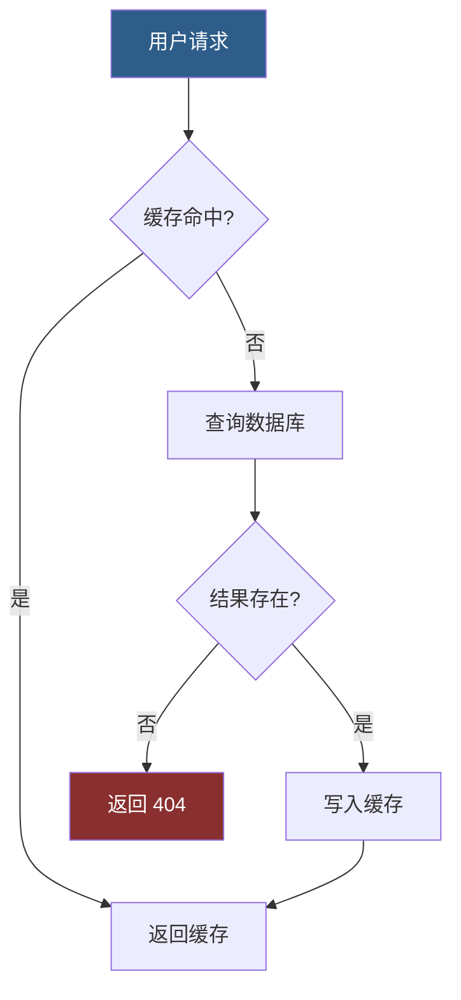
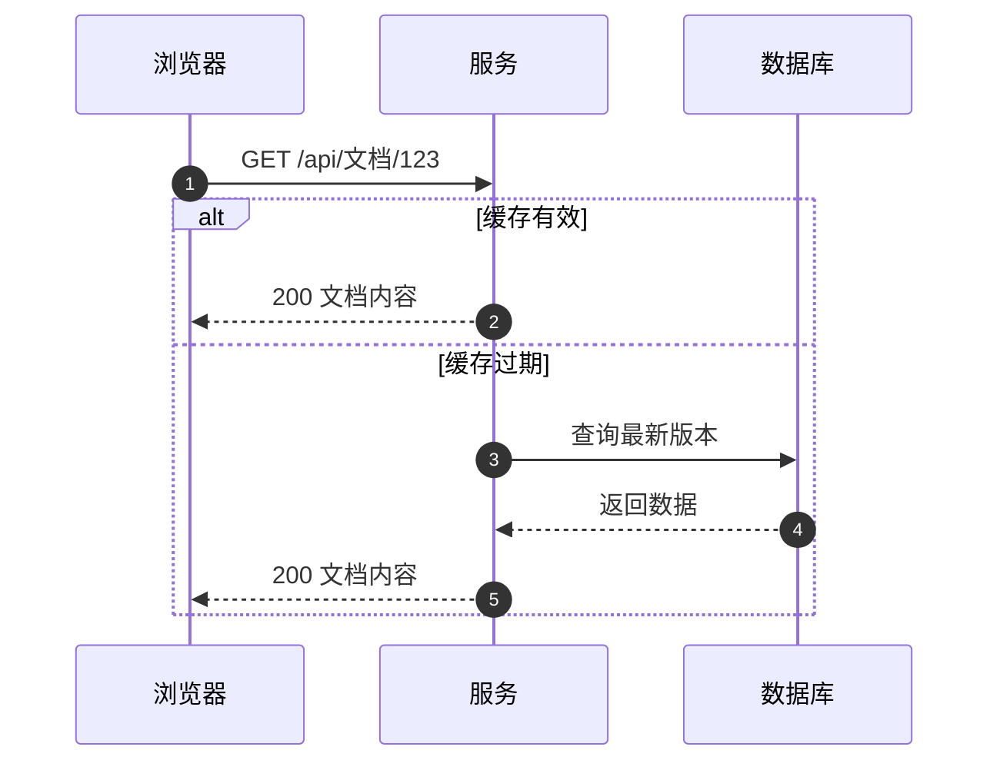

@@ meta

# MDEditor 使用指南

**本工具由 AI 辅助生成**：零依赖单文件 Markdown 编辑器，左侧写作、右侧实时渲染，全程本地运行。

> 本指南对应 **v2.21.0**。语法有增补时，先看文末「语法速查」；每条写法后面的章节名指向详细说明。

## English at a glance

The interface is bilingual. The small **EN / 中** button in the status bar switches the whole UI language; the document itself is never translated. English labels are kept short so the toolbar still fits, and every rule below still applies.

| Task | How |
| --- | --- |
| Open | Double-click a `.md` file, or use **Open**. File association is created by the installer. |
| Save / Save as | **Save** writes back to the original file; **As…** picks a folder and a format (`.md` with a sibling `.assets` folder, or a single-file `.smd`). |
| Split / follow | **Split** cycles editor-only, split, preview-only. **Follow** keeps the preview scrolled to the cursor. |
| Print / PDF | **Print** builds a paged HTML (paper, page numbers, contents, figures and tables numbered) and opens it; press `Ctrl+P` there to print or save as PDF. |
| Export | `.html` for a styled single file; `.docx` for an editable Word file with styles and real formulas. |
| Typesetting | **TS** opens fonts and sizes, table style, paragraph indent, paragraph gap, hanging list markers, page setup and autosave. |
| Image output | **TS → Image output**: *Original* (default, untouched), *300 dpi* or *150 dpi*. Export copies are downscaled to each image's real printed width (`width_mm ÷ 25.4 × dpi`), never upscaled, and only when it actually saves bytes. Print/PDF, `.html` and `.docx` all follow; the files on disk are never modified and the preview always uses thumbnails. |
| Language | Status bar **EN / 中**, remembered on this machine. |
| Offline | KaTeX, Paged.js and the four diagram engines (Mermaid, Graphviz, WaveDrom, Vega-Lite) are bundled; only remote images and links need the network. |
| Extensions | `@@ begin fill {50\|50}` … `@@ end fill` (columns), `@@ blank{n}` (exact vertical space), `@@ begin full` (own page on print), `@@ begin page{noll\|1\|i\|I}` (page-number regions: no numbers / arabic / roman, `{p}` page, `{P}` total, `{N}` pages in this region; `page`+`full`+`color` can be combined in one block, write `fill` nested), `@@ MDE_…` (Python data points). The cheat sheet at the end carries an English note on every row. |

## 一、基础语法

支持 *斜体*、**加粗**、~~删除线~~、`行内代码`，以及 [链接](https://example.com)。

> 引用块：把「>」放在行首。引用内部同样支持**加粗**等行内语法。

### （一）上下标（角标）

正文直接写，**不需要 `$`**：`^{内容}` 得上标、`_{内容}` 得下标。

示例：a^{2}+b^{2}=c^{2}、H_{2}O、x_{i}^{2}。

- 只认紧跟花括号的写法：`^{…}` / `_{…}`；缺右花括号、或写成 `a^b`，一律按字面显示
- 花括号内不跨行、不嵌套花括号；上下标可连写（`x_{i}^{2}`）
- 要显示字面的 `^{1}`，写 `\^{1}`（反斜杠转义）
- `行内代码`与代码块内**不转**角标，保持原样
- 与数学公式的分工：包进美元符的整段交给 KaTeX（数学字体、数学间距）；角标只是正文里的 HTML 上下标，跟随正文字体与字号

### （二）文字颜色 `@@ color`

给一段文字上色。行内与块级两种写法，色值规则相同。

**行内**：`@@ color r{这段是红的}` —— 花括号内是要上色的文字，可与**加粗**、~~删除线~~、`x^{2}` 等行内语法混排。

**块级**：整块着色，块内还能用行内写法局部覆盖：

@@ begin color g
块级第一段（绿色）。

第二段，含 @@ color r{局部红}。
@@ end color

色值可写简写字母，也可直接写 HEX：

| 简写 | 颜色 | 简写 | 颜色 |
| --- | --- | --- | --- |
| `r` | 红 `#e53935` | `g` | 绿 `#43a047` |
| `b` | 蓝 `#1e88e5` | `y` | 黄 `#f9a825` |
| `o` | 橙 `#fb8c00` | `p` | 紫 `#8e24aa` |
| `c` | 青 `#00acc1` | `m` | 品红 `#d81b60` |
| `k` | 黑 `#000000` | `w` | 白 `#ffffff` |
| `a` | 灰 `#757575` |  |  |

HEX **不带 `#`**（误写 `#` 也认）：3 位 `f00`、6 位 `99b3c1`、8 位 `99b3c180`——8 位末两位是**透明度**（`80` ≈ 50%，仅预览与 HTML／打印生效）。块级也可写成花括号形式：`@@ begin color {99b3c1}`。

- 内容不跨行；花括号按层计数（`@@ color r{价 x^{2}}` 合法）
- 块级着色是容器级块：**紧贴列表也不继承列表缩进**，从版面左边缘起算
- 不支持自嵌套：内层 `@@ color` 按字面露出
- `行内代码`与代码块内不生效，保持原样
- 色值非法（如 `@@ color zz{…}`）或花括号未闭合：**原文原样显示**，便于发现笔误
- 导出：预览、`.html`、打印／PDF、docx 四处颜色一致；docx 只带 RGB，**丢弃 8 位 HEX 的透明度**
- `w` 是纯白：白纸白字同样看不见，工具不做反色处理

### （三）块级语法与换行规则

**总则一句话：块级语法必须独占一行。**

标题 `#`、代码围栏（三反引号开头的代码块）、块级公式 `$$…$$`、引用 `>`、表格、分隔线 `---`、缩进块 `<<<`、`@@` 系列块（`begin` / `end` / `caption` / `blank`）都算块级语法。判据只有一条——**这一行除了该语法本身，不能再夹带别的文字**。

- **独占一行 ≠ 前后必须空行**：紧贴上一段、紧贴列表项都照常生效，中间不需要空行
- 行首缩进：`@@` 块、`<<<`、引用、分隔线容忍少量前导空格（≤3 个）；**标题与围栏必须顶格**
- 与文字同行时（如 `前言：## 标题`、`说明：@@ begin fill{50|50}`）整行按普通文字处理，块级语法按字面显示——避免误伤正文（图片例外：与文字同行的图仍是行内图，`{N}` 照常改宽度，但**不成图容器**，题注与上下位置不生效）
- 想让一个块级语法退化成行内文字，把它并进上一行即可

**换行与分段：**

| 输入 | 效果 |
| --- | --- |
| 单回车（一行接一行） | **换行不换段**：同一段内断行 |
| 双回车（空一行） | **分段**：切成两段，各自吃段间距 |
| 连续多个空行 | 与一个空行**等价**，不产生额外空白（要精确空白用 `@@ blank{n}`） |

**双回车同时是截断条件**：列表、引用、`<<<` 缩进链、`@@` 块的延续都只认紧随其后的行；隔一个空行即断开（列表断开后重新从 1 编号，缩进链回到零基准）。

**分隔线只认 `-` `*` `_`**：整行三个以上同一字符成线（`---`、`***`、`___`）；`xxxx`、`。。。` 这类占位符**不再**被当成横线。

## 二、列表与任务

本工具的无序列表标记有独立语义（详见文末「语法速查与本工具的特殊写法」）：

`+` 渲染**实心圆点**，`-` 渲染**空心圆圈**，样式跟标记符走、与缩进无关（缩进只决定嵌套层级）：

+ 实心点列表项（加号）
- 空心圈列表项（减号）
  - 嵌套子项（缩进决定层级，样式仍跟自己的标记符走）

> 注意：**缩进嵌套子项是兼容语法**——仅为承接外部 Markdown（粘贴自 GitHub / Typora / AI 输出等）而保留，保证外部文档的多级列表不拍平。本工具自己表达层级退层的标准语法是 `<<<` 缩进包围块（见「缩进包围块」章节）：列表内部的层级细分、任意内容的整体缩进，都建议用 `<<<` 书写。

1. 有序列表项一
+ 单行回车不断序
  - 单行回车不断序
2. 有序列表项二（编号接力：显示编号由渲染器决定，输入数字只是标记）

- [x] 已完成任务
- [ ] 待办任务

> 注意：`*` 不作列表标记（`*星号*` 是斜体、`**双星**` 是加粗），行首 `* 内容` 会按普通段落处理。

**列表的断续与编号：**

- **只有空行会结束列表**；空行之后的第一个列表项重新从 1 编号
- **紧贴列表的块级语法不结束列表**：标题、围栏、表格、引用、`<<<`、`@@` 块渲染在项与项之间，后续项**编号接力**（跨过标题、围栏、表格仍是 2、3、4…）；分隔线则渲染在**当前项内**（项内一条横线）
- 同一项内的续行（单回车）仍是这一项，不断序
- **项内的整行图片按块渲染**：`{N}`、`c/l/r`、题注全部生效——宽度基准是该列表项的**内容宽**（不是版面宽），所以 `{70}` 是「列表项宽度 × 70%」；项内整行的 `---` 渲染成横线
- 想让列表在某个块级语法处**彻底断开**（后续从 1 重新编号）：在这个语法前后各空一行

**标记外凸（续行悬挂，v2.14.0，默认关闭）：**

排版面板「段落缩进」小节里，「列表」那一行上方有一个勾选——**列表标记外凸**。打开后：

```
关（默认，顶格）        开（外凸）
1. □首行文字            1. □首行文字
□续行文字                  □续行文字
```

- 关：标记是文字流的一部分，续行只能从句首起排，于是落到 `1.` 的左下方
- 开：标记站到文字块外面（让进左侧标记槽），文字块整体右移一槽，**续行与首行文字左沿对齐**
- 档位数字的含义不变，只是「文字块从哪儿开始」换了算法；**正文段落缩进与 `<<<` 包围块完全不受影响**
- 打开后嵌套列表开始有水平层级缩进（每层一个槽）；有序列表的槽比无序宽，给两位数编号留位置
- `- [ ]` / `- [x]` 任务项不再离群：v2.14.0 删掉了它历史上那段肉眼估的负边距，方框从此跟兄弟项吃同一套列表几何；导出 docx 时也是真字符 `□` / `☑`，不再是空框
- 打印/PDF、`.html`、docx 三条通道同口径；开关状态随排版设置保存在 `runtime/ui-settings.json`

## 三、代码块

```python
print("hello markdown")
```

## 四、表格

| 功能                                           | 状态 |
| -------------------------------------------- | -- |
| 实时预览                                         | 支持 |
| 导出 HTML / 分页 PDF                             | 支持 |
| 图片渲染（png/jpg/webp/gif）                       | 支持 |
| LaTeX 公式                                     | 支持 |
| Mermaid / Graphviz / WaveDrom / Vega-Lite 图表 | 支持 |

**表格题目（题注）`@@ caption`**：紧贴表格**上一行**写 `@@ caption{参数} 题目文字`，题目与表格渲染为一体：

```
@@ caption{c t s0.5} 表 1　门店月度销量
| 月份 | 销量 |
| --- | --- |
| 一月 | 120 |
```

- 参数组写法与图题完全同一套 token（详见「图片 · 图题」）：`l/c/r` 水平对齐、`t/b` 题注在表格之上/之下、`w/n` 超宽裁剪/换行、`s<n>` 间距 = n×题注字号；**默认 `t`（题注在表格上方）、间距 `s0.3`**
- 参数组 `{}` 可整体省略：`@@ caption 表 1　门店月度销量`
- 只认「紧随其后的那一个表格」；后面不是表格时整行按普通文本显示（fail-closed，不吞字）
- 题目文字走完整行内解析，可加粗、可着色
- 「排版」面板「表题」一行可设题注的字体、字号、对齐；「图 / 表编号」打开后自动加「表 1」「表 1-1」序号
- 预览 / 导出 HTML / 打印 / 导出 docx 同口径渲染；docx 里题注用 Word 的 Caption 样式，位置（表格前/后）按 `t/b` 决定

## 五、数学公式（KaTeX，本地渲染、离线可用）

行内公式：质能方程 $E=mc^2$，欧拉公式 $e^{i\pi}+1=0$。

块级公式：

$$\int_a^b f(x)\,dx = F(b)-F(a)$$

$$\sum_{k=1}^{n} k = \frac{n(n+1)}{2}$$

$$I = \iiint\limits_\Omega f(x,y, z) \mathrm{d} V$$

$$I=\iiint\limits_{\substack{x^2+y^2+z^2\le R^2\\ z\ge 0}}f\!\left(x,y,z\right)\mathrm{d}V$$

$$a_0+\cfrac{1}{a_1+\cfrac{1}{a_2+\cfrac{1}{a_3+\cfrac{1}{a_4+\cdots}}}}$$

$$
\sqrt{1+\sqrt{2+\sqrt{3+\sqrt{4+\cdots+\sqrt{n}}}}}\;
=\;
\sqrt[3]{\frac{1+\sqrt[4]{x}}{1-\sqrt[5]{y}}}
$$

$$
\sum_{\substack{1\le i\le n\\ i\ \mathrm{odd}}}
\ \prod_{j=1}^{m_i}
\frac{a_{ij}}{\displaystyle\sum_{k=1}^{j} b_{ik}}
$$

公式标记只在正文生效：`行内代码`与代码块里的 `$…$` 保持字面，不会变成公式（想展示语法原文就写进反引号里）。正文里要显示字面的美元符，写 `\$`。


## 六、图表作图（四种，全部本地渲染、离线可用）

把代码块的语言标记写成对应引擎名，预览区会把它渲染成图，改左侧源码即实时重渲：

| 围栏                               | 引擎        | 擅长                   |
| -------------------------------- | --------- | -------------------- |
| ` ```mermaid `                   | Mermaid   | 流程图、时序图、状态机、甘特图、思维导图 |
| ` ```dot `（或 `graphviz` / `viz`） | Graphviz  | 复杂依赖拓扑，自动布局质量最高      |
| ` ```wavedrom `                  | WaveDrom  | 数字信号时序波形（协议握手、寄存器时序） |
| ` ```vega `                      | Vega-Lite | 数据图表（柱状、折线、散点等）      |

图表围栏同样支持**版面百分比宽度**：在语言标记后加 `{数字}`（如 ` ```mermaid {30} `），图宽 = 版面宽度的 30%、等比缩放，规矩与图片宽度参数完全一致（空格可省、`{150}` 钳到 100、非法值不生效且字面原样显示）；不带参数时维持默认行为（大图不超过版面宽，小图保持原始尺寸）。宽度参数只影响渲染，**不改任何源文件**。

### （一）Mermaid：流程图（带判定分支与样式）



### （二）Mermaid：时序图（编号消息 + 分支场景）

@@ begin fill {40|60}



@@ end fill

### （三）Graphviz (DOT)：模块依赖拓扑


### （四）WaveDrom：请求握手时序波形

```wavedrom{50}
{ "signal": [
  { "name": "clk",  "wave": "p......." },
  { "name": "req",  "wave": "01.0...." },
  { "name": "busy", "wave": "01......" },
  { "name": "data", "wave": "x345x...", "data": ["头部", "正文", "校验"] },
  { "name": "ack",  "wave": "0....10." }
]}
```

### （五）Vega-Lite：数据柱状图

```vega{50}
{
  "$schema": "https://vega.github.io/schema/vega-lite/v5.json",
  "data": { "values": [
    {"day": "周一", "words": 1200}, {"day": "周二", "words": 1850},
    {"day": "周三", "words": 940},  {"day": "周四", "words": 2100},
    {"day": "周五", "words": 1560}, {"day": "周六", "words": 320},
    {"day": "周日", "words": 0}
  ]},
  "mark": "bar",
  "encoding": {
    "x": {"field": "day", "type": "nominal", "sort": null},
    "y": {"field": "words", "type": "quantitative", "title": "每日字数"}
  }
}
```

> 说明：四种图表引擎均为**按需懒加载**——文档里没有图就零开销，首次出现对应围栏才加载本地引擎；渲染失败时容器内原样显示源码与错误信息，不会吞错；暗色 / 亮色主题切换时已渲染的图会按新主题重绘。`wavedrom` 与 `vega` 围栏内必须是**严格 JSON**（不支持 JS 对象字面量的裸键名）。

## 七、图片

图片语法：``。下面这张图放在**同名资源目录**里，用相对路径引用——**`.md` 与 `.assets/` 是一对，一起拷贝即可完整迁移**：

@@ begin fill{50|50}
{:c t n s0.5}

{:c t n s0.5}
@@ end fill

网络图片写法相同，把括号内换成 https:// 图片网址即可（需联网）。

**本地图片**：直接复制一张图，在编辑区按 `Ctrl+V` 粘贴即可——编辑器会自动把它存到**同名资源目录**，并插入正确的相对引用，无需手写路径：

```
你的文档.md
你的文档.assets/          ← 图片都自动归到这里
    └ 20261014_235812_3421.png
```

文档里的引用形如 ``，与图片实际存放位置一致，预览即可显示。

> 提示：`Ctrl+V` 前请先保存文档（无文件路径时无法确定资源目录）。`.md` 与 `.assets` 目录是一对，一起拷贝给别人即可完整打开。

### （一）图片宽度参数 {N} 与对齐后缀 c / l / r

在图片引用后加 `{数字}`，这张图的宽度就 = **版面宽度的 N%**，高度等比缩放。基准是**版面**而不是原图：两张原图大小不同的图，只要参数相同，显示宽度就相同。下面是同一张图两次——第一次不带参数（大图按版面 100% 显示），第二次 `{40}`（版面的 40%）：

{l}

{50l}

- 参数范围 1~100：`{150}` 按 100 处理；`{0}`、`{abc}` 等无效值不生效（后缀原样显示，便于发现笔误）
- **单图对齐后缀**：`{40c}` 居中 / `{40l}` 左 / `{40r}` 右（`{c}` 纯对齐也合法）——单图覆盖「排版」面板的图片全局对齐档；不带后缀时按面板全局档
- 网络图片与本地图片写法相同
- 分页导出时同样相对**页面版心**生效；超长图先按参数定宽，再按调整后的实际高度切片续排，条带保持同一宽度
- **原始图片文件只读不写**：参数只决定渲染与排版尺寸，预览、导出、分页切片（切片产生的是缓存副本）均不修改原图
- 图表围栏（mermaid / dot / wavedrom / vega）支持同一参数（含对齐后缀）：` ```mermaid {30r} `，规矩与此处完全一致

### （二）图片分栏 @@ fill

多张图（或图表）并排成行时用分栏语法包裹，比例 = 各栏占**版面宽度的百分比**（与 `{N}` 同口径）：

```
@@ begin fill {50|50}


@@ end fill
```

- 2~4 栏：`{50|50}`、`{30|30|40}`、`{25|25|25|25}`；**比例相加须 = 100**，否则整块按普通文本显示（fail-closed，便于发现笔误）
- **参数可整体省略**：只写 `@@ begin fill`（不带 `{…}`）就是**等分**——2 栏 50/50、3 栏 33/33/34、4 栏 25/25/25/25；栏数由空行分隔出的段数决定，段数不在 2~4 之间时整块按普通文本露出
- **栏内容按空行分隔**：每栏 = 一段连续内容（一个图表围栏、若干图片行，或一个/几个文字段落，可混排）；段数必须等于栏数
- **栏内 `{N}` 失效**：**栏内图一律相对栏 100%**（撑满栏，小图同样放大）——与不分栏 `{N}` 相对版心同一语义：分栏的栏比例就是宽度参数（版心百分比已经"付过费"），栏内不再二次百分比，写了 `{N}` 也不生效；**带图题的图同样如此**，对齐 / 上下 / 裁剪 / 间距等题注参数照常生效，导出 docx 时图宽=栏宽
- 栏内容可以是图片与图表混合（` ```dot ` 围栏与 `` 混排）
- **紧贴列表也照常分栏**：`@@ begin fill` 与上一个列表项之间**不需要空行**；包围块从版面左边缘起算，**不继承列表缩进**（不会因为紧挨着列表就整体右移一档）
- 预览 / 导出 HTML / 打印 / 导出 docx 同口径渲染（docx 以无边框表格作布局骨架）
- 未闭合（缺 `@@ end fill`）时整块按普通文本渲染

### （三）图题（题注）

在图片引用 `()` 内末尾用空格 + `"…"` 写题注文字，图片**独占一段**（或独占列表项内的一整行）时渲染成带题注的图容器（题注在图框内、随图走）：

```

```

参数组用 `{图参:题参}`，**冒号前是图的参数、冒号后是题注的参数**，两段沿用同一套 token（空格或逗号分隔、顺序自由、认不出的忽略）：

| token | 作用 |
| --- | --- |
| `l` / `c` / `r` | 水平对齐：左 / 中 / 右 |
| `t` / `b` | 题注在图**之上 / 之下**（图默认 `b`） |
| `w` / `n` | 题注文字超宽时**裁剪**（单行省略号）/ **换行**（默认 `n`） |
| `s<n>` | 题注与图的间距 = n×题注字号（默认 `s0.3`；题注在上落到下间距、在下落到上间距） |

示例：`{50l:c t s0.5}` —— 图宽版面 50%、居左，题注居中、在图上方、间距 0.5 倍字号。

- 题注对齐没单独给时**跟随图的水平位置**（图居中 → 题注居中）
- 带题注时宽度 `{N}` 归图容器、图片填满容器；没写 `{N}` 时图容器宽 = 图片**自然宽**（题注按图宽换行/裁剪）；**不带题注**的 `{N}` 仍是旧语义（宽度直接落在图片上）
- 图参照旧支持「图片宽度参数」的 `1~100` 钳制与非法值不生效
- 「排版」面板「图题」一行可设题注的字体、字号、对齐；「图 / 表编号」打开后自动加「图 1」「图 1-1」序号（编号是纯文本，源文不回写）
- 预览 / 导出 HTML / 打印 / 导出 docx 同口径渲染；docx 里题注用 Word 的 Caption 样式（已钉黑不随主题变色），题注段落缩窄到图宽、带间距与对齐，`w/n` 按 Word 自然行为处理
- **四种图表围栏同样支持图题**：`` ```mermaid "图 1　流程"{40l:c t s0.5} `` —— `"…"` 写题注、`{图参:题参}` 与图片同一套 token（冒号前宽/对齐、冒号后 l/c/r、t/b、w/n、s<n>）；无 `"题注"` 的围栏（`` ```mermaid {30r} ``）行为不变。docx 里图表先栅格化成图片再进 Word，题注同走 Caption 样式

## 八、low runner（工具栏「run」按钮）：文档内数据自动化计算

在写作中声明**数据点**，再调用 Python run（自己写或 AI 生成）对全文数据做计算、合并、筛选、统计、画图——文档数据的自动化加工，不做系统级功能。

### （一）数据点（数据声明，v2.6 六形式）

| 写法 | 渲染 | run 收到的类型 |
| --- | --- | --- |
| `@@ MDE_甲{文本}` | 显示原文 | `vals` += str |
| `@@ MDE_甲{苹果 == 3}` | 显示 `3` | `kv['苹果'] = '3'`（str） |
| `@@ MDE_甲{8%,1.5%,0.6%}` | 显示原文 | `vals` += list（纯值向量） |
| `@@ MDE_甲{A == 8%, B == 1.5%}` | 显示 `8%、1.5%` | `kv` 合并两键（dict） |
| `@@ MDE_甲{2025年，…上涨((8%))，…((1.5%))…}` | 去 `(( ))` 的干净句子 | 抽取 `8%`/`1.5%`（行文形式，同上两种） |
| `@@ MDE_甲:2(2x2){表格}` | 原样一张表格 | `vals` += 嵌套 list（二维） |
| `@@ MDE_甲:3(2x2){表␣␣表}` | 原样多张表格 | `vals` += 三层嵌套 list |

- **`(( ))` 行文抽取**：数据长在正文句子里，双括号圈出值——句子照常读、数据照常传；`((v))` 纯值 / `((k == v))` 键值（不可混用）；抽出的片段在 `vals` 里落成**一个 list 元素**（与形式3 同形，如 `vals=[["外国人","聊了","很多各自的见闻"]]`），代码按 list 取，别按 str 取
- **表格型 `:N(rxc)`**：`(rxc)` 为 1-based 起始坐标（`(2x2)` 从第 2 行第 2 列起取到表尾；`()` 空括号=全表）；分隔行 `|:-|:-|` 不计行号不进输出；单元格一律 str、空补 `""`、`\|` 为字面竖线；`:3` 表格间空行分隔
- 半角 `,` = 向量分隔符（值内要逗号：全角 `，` 或行文形式）；**方括号、引号里的半角逗号同样算分隔符**——`['a','b']` 会被拆坏，整块 fail-closed 成普通文本（数据静默丢失）；语法违规（混用/未闭合/坐标越界/键值段无 `==`）**fail-closed** 整块按普通文本
- 显性/隐性（`MDE_甲` / `MDE__甲`）与别名池对全部六形式一视同仁；`raw` 原文通道永远保留（逃生舱）
- 完整规范见 `docs/low runner 数据形式规范.md`

### （二）外部文件引用（v2.8：把 xlsx / pdf / csv 交给 run）

从资源管理器复制一个文件，在编辑区 `Ctrl+V`：

1. 字节复制进本文档资产目录，**保留原文件名**（`.md` → `<文档名>.assets/`，`.smd` → 包内 `assets/`）；
2. 自动插入一行数据点，值是相对路径：`@@ MDE_甲{销售数据 == <文档名>.assets/销售数据.csv}`；
3. 执行时服务端把这个值换成**绝对路径**再交给 run，`open(data['kv']['销售数据'], 'rb')` 直接能读。

- **只复制一次**：粘贴那一刻之后与原文件断链；用「打开」改的也是这份副本，原文件怎么变都与文档无关
- **框架不解析任何文件**：xlsx 怎么解、pdf 怎么拆，全部由 run 自己决定（要三方包自己装到 `runtime/pylibs`）
- **池名与显隐性跟着你的写法走**：插入时照抄文档里最近一个数据点的前缀，想换池、改显性/隐性改那几个字符即可
- **显性**引用后面带一个「打开」按钮：调系统关联程序打开副本；打开之后，吃这个池的执行点全部回到「待运行」——不拿旧结果冒充
- 剪贴板里是**文字**（含从 Excel 复制的选区）或**网页图片链接**时不走这条，行为与原来一致
- 上限单文件 20MB；同名不同内容加短哈希后缀（`数据__a1b2.xlsx`）不覆盖；文件名里的 `,` `=` `{` `}` 换成 `_`（它们是数据点分隔符）
- 文档未保存时先 `Ctrl+S`：没有资产目录可落

### （三）执行点（调用 run）

- `@@ MDE import dark` → 执行 `runtime/runs/dark.py` 的 `run(data)`，吃**公共池**数据
- `@@ MDE import dark is zzz` → 同一 run，只吃 `@@ MDE_zzz{}` / `@@ MDE__zzz{}` 的**别名池**数据
- `@@ MDE from utils import add is xxx` → 执行 `utils.py` 的 `add(data)`，只吃 `is xxx` 池
- **`{global p}` 全局执行**（v2.6）：`@@ MDE from refnumber import run{global p}` → 全文 `'''p` 标记按顺序进 `data['marks']`（每项含所在句），run 返回**等长列表**逐个替换标记（如自动上标 `^{[1]}`、`^{[2]}`）；可与 `is 池`并存；执行点自身不渲染；标记名任意单词，多个 global 各管各的；未运行标记显示原文 `'''p`；**替换只做一轮**（替换文本里再出现 `'''p` 不会二次展开）
- **别名规则统一**：`import` 与 `from import` 两种形式都支持 `is`，无 `is` 一律公共池——同一 run 多处调用时用 `is` 区分各处数据（谁的数据谁明确）
- 什么时候执行：**默认手动**——渲染完只把执行点标成「▶ 待运行」，点它或左下角「运行」才真的跑；在「run → 运行模式」里改成**立即／等待 N 秒**则渲染后自动跑（见第（七）节）
- 执行时按别名分桶收集数据点，每个执行点吃自己桶的数据（公共池/别名池位置无关），各自调 run，结果替换执行点
- run 失败/不存在：执行点显示原文（fail-closed，便于发现笔误）
- 会话内结果缓存（数据不变不重跑）；run 库保存/删除后自动清缓存重跑

### （四）run 代码协议

```python
def run(data):          # 函数名固定 run（from 形式则用目标函数名）
    data["kv"]          # {"苹果": "3", "梨": "2"} —— 框架按 == 剥离好的
    data["vals"]        # ["一段话", ["3","4"], [["tony","59"]], ...] —— 元素形状随写法
    data["raw"]         # ["苹果 == 3", "备注 == 内部口径", ...] —— 原文兜底
    data["marks"]       # 仅 {global p} 执行点有：[{"mark":"p","ctx":"所在句"}, ...]
    return "5 个水果"    # 返回 str 替换执行点；global 执行点返回等长 list[str]
```

- **一个角色一行**：上面第一行是正文（形式1 整句）'''ref ，第二行'''ref 是关键词列表（形式3 半角逗号分隔的纯值向量），两行用同一个池名合并；代码按类型分（str 是正文、list 是词表），关键词随时增删不用改代码
- **两组数据不能靠一行兼顾**：行文抽取 `(( ))` 只把括号里的值交出去、句子本身只用于显示不进数据；半角逗号切分只交出一串值、交不出整句——所以"既当正文又当词表"在数据契约上做不到

- 解释器 = 本工具自带便携 Python（**仅标准库**）；三方包自装：`pip install --target runtime/pylibs matplotlib`（「run」界面有「依赖目录」按钮直达）
- **作图**：图片一律写进**本文档的资产目录**（`.md` 是 `<文档名>.assets/`，`.smd` 是包内 `assets/`，也就是 run 的当前工作目录），存 `chart.png` 就返回 ``；换机器、导出 docx/HTML、存成 `.smd` 都带得走
- 旧写法存 `run_cache` 仍能显示（兜底保留），但那份既不会被清理也带不走，不建议再用
- run 内可用中文函数名/文件名（`@@ MDE from 统计 import 合计`）
- 执行防护：超时 10 秒、输出上限 1MB
- **返回值按形状显示，不做猜测**：单行 `str` 跟在执行点原位；带真换行 `\n` 的 `str` 逐行显示；写成分隔表格（表头行 + `|---|---|` + 数据行）就渲染成真表格，分隔行自身不显示，缺分隔行则整段当文字；普通执行点返回 `list` 会逗号连成一行
- **表格示例**：`return "|项目|一月|\n|---|---|\n|收入|100|\n|成本|60|"` → 一张两列三行的表；单元格里的竖线写 `\|`；单元格内不能换行、不能合并单元格
- 返回值里出现 `@@ MDE…` 或 `'''标记` 只当普通文字，不会生成数据点

### （五）数据写作（怎么把数据写进编辑区）

数据点是**一行字**，不是表单：`@@ MDE_池名{内容}`。同一个池名写多少次都行，run 拿到的是这个名字下的**全部**内容。写法有四种，run 收到的东西完全不同——用哪种，只看你要交出去什么：

| 你写 | run 收到 | 什么时候用 |
|---|---|---|
| `@@ MDE__甲{128000}` | `vals` 多一个 `"128000"` | 一个值 |
| `@@ MDE__甲{一月, 二月, 三月}` | `vals` 多三个元素 | 一串值（半角逗号是分隔符） |
| `@@ MDE__甲{一月 == 128000, 二月 == 143500}` | `kv` 多两个键 | 带名字的值：画图、查表、配置 |
| `@@ MDE__甲:2(2x2){` + 表体 + `}` | `vals` 多一个嵌套 list | 二维表（见下面示例 1） |

四条硬规矩：

1. **数字到手是字符串**：`kv["一月"]` 是 `"128000"` 不是 `128000`，`"128000" + 1` 会报错，run 里自己 `float()`。
2. **值里不能有半角逗号**：逗号就是分隔符。要千分位就写全角 `128，000`，或者干脆不写。
3. **一个下划线显性、两个下划线隐性**：显性把内容显示在预览区，隐性只把数据交给 run、屏幕上什么都不留。数据是喂给 run 的，池名就写两个下划线。
4. **顺序就是书写顺序**：`kv` 是 dict，键序跟你写数据点的先后一致，画图按这个顺序排。

run 里怎么读：

```python
def bar(data):
    for k, v in data["kv"].items():     # 一月、二月、三月……按你写的顺序
        print(k, float(v))
```

同一个池可以同时喂给多个执行点：`@@ MDE from plotimg import bar is 月度` 和 `from plotimg import line is 月度` 读的是同一份数据，不用抄两遍。

### （六）完整示例

#### 1. 一份 CSV 的行列单元格运算（返回表格）

资产目录里带了一份模拟销售数据 `示例销售数据.csv`，run 库里的 `csvcalc` **只用标准库 `csv`** 读它，按整表 / 行 / 列 / 单元格做四则运算，**结果一律返回一张 Markdown 表格**——所以预览区是真表格，导出 docx 也是真 `w:tbl`。

@@ MDE_销售{表格 == MDEditor 使用指南.assets/示例销售数据.csv}

> 这一行是 v2.8 的外部文件引用：run 收到的是**绝对路径**；点后面的「打开」能用 Excel 直接看这份副本。

**① 原样读出来**（不给「运算」= 不改数，先确认文件读对了）

@@ MDE from csvcalc import table is 销售

**② 整表 ×1.1**（全表上浮 10%，表头与门店名原样不动）

@@ MDE__销售b{表格 == MDEditor 使用指南.assets/示例销售数据.csv, 运算 == *, 数 == 1.1}

@@ MDE from csvcalc import table is 销售b

**③ 某一行 +5000**（`行名` 按第 1 列的文字定位；也可写 `行 == 3`，表头算第 1 行）

@@ MDE__销售c{表格 == MDEditor 使用指南.assets/示例销售数据.csv, 行名 == 上海静安店, 运算 == +, 数 == 5000}

@@ MDE from csvcalc import row is 销售c

**④ 某一列 −60000**（`列名` 按表头文字定位；也可写 `列 == 2`，第 1 列是门店名）

@@ MDE__销售d{表格 == MDEditor 使用指南.assets/示例销售数据.csv, 列名 == 一月, 运算 == -, 数 == 60000}

@@ MDE from csvcalc import col is 销售d

**⑤ 单元格 ÷ 单元格**（`列名2` 给第二个操作数，算三月相对一月的倍数）

@@ MDE__销售e{表格 == MDEditor 使用指南.assets/示例销售数据.csv, 行名 == 北京朝阳店, 列名 == 三月, 列名2 == 一月, 运算 == /}

@@ MDE from csvcalc import cell is 销售e

- **表格是返回值写的，不是框架拼的**：`return "|项目|一月|\n|---|---|\n|收入|100|"` 这种字符串就是入口，run 想返回多少列多少行都行
- 不可解析的单元格（空、文字）**原样保留**并在「说明」列标出，不炸整张表；找不到行名/列名会列出可选值；除数为 0 显示 `除数为0`
- 「行 / 列」两种定位可以混用：`行名 == 上海静安店` 和 `行 == 3` 指同一行，前者改了 csv 顺序也不跑偏
- 换自己的数据：把 csv 粘进文档（路径照抄粘贴生成的写法），再照 `csvcalc.py` 的开头注释改口径即可

#### 2. 直接引用计算

|名称|数量|
|:-|:-|
|苹果|@@ MDE_kkk{A == 3}|
|梨|@@ MDE_kkk{B == 4}|

总共有水果 @@ MDE from stats import add is kkk 个

> AI生成提示词：求数据点里的加、减、乘、除、中位数、平均数、标准偏差、相对标准偏差，只用标准库（8b模型）。

#### 3. 查询并计数

@@ MDE_bbb{今天遇到一个外国人，他对我说“你好”，我也回应他“你好”。我们聊了一下午，说了很多各自的见闻，最后我才发现，他说的竟然是中国话。}

@@ MDE__bbb{你好,中国话}

@@ MDE from wordcount import count is bbb

> AI生成提示词：统计某段里某词出现次数，某词应可以轮询（8b模型）。

#### 4. 标记并合并

@@ MDE_vvv{今天遇到一个((外国人))，他对我说“你好”，我也回应他“你好”。我们((聊了一下午))，说了很多各自的((见闻))，最后我才发现，他说的竟然是中国话。}

@@ MDE import mergecontent is vvv

>  AI生成提示词：在一段话中，将我标出的内容合并（8b模型）。

#### 5. 表格计算

@@ MDE_甲:2(){
| 项目 | 一月 | 二月 |
| --- | --- | --- |
| 收入 | 100 | 120 |
| 成本 | 60 | 80 |
}

@@ MDE__甲{行 == 2, 列 == 3, 数 == 2, 运算 == *}

|单元格：|@@ MDE from tablecalc import cell is 甲|
|:-|:-|:-|
|整行翻倍：|@@ MDE from tablecalc import row is 甲|
|整列翻倍：|@@ MDE from tablecalc import col is 甲|
|行求积：|@@ MDE from tablecalc import rowagg is 甲|
|列求积：|@@ MDE from tablecalc import colagg is 甲|

> AI生成提示词：二维表格的行、列计算与单元格计算，包含+-*/ (云端完整大模型）。

#### 6. 全局标记并递增

@@ MDE from auto_cite import run{global ref} 

...一个角色一行**：上面第一行是正文（形式1 整句）'''ref ，第二行'''ref 是关键词列表...

> AI生成提示词：根据我的标记，为我自动生成上标引用编号，形式为^[x]，其中数字x自动递增 (20-40b模型+人工微调）。

#### 7. 用数据点画图（返回图片）

run 库里的 `plotimg` 用工具自带的 Pillow 直接把编辑区的数据画成图：不调外部服务、不装 matplotlib，**一个数据点进，一张 png 出**。

数据（隐性池：池名前面两个下划线，这行不显示在预览区，只把数据交给 run）：

@@ MDE__月度{标题 == 门店月度销量, 单位 == 元, 一月 == 128000, 二月 == 143500, 三月 == 152300, 四月 == 167900}

**① 柱状图**

@@ MDE from plotimg import bar is 月度

**② 折线图**

@@ MDE from plotimg import line is 月度

**③ 圆环图**（看占比，图例带百分比）

@@ MDE from plotimg import donut is 月度

- **图是 run 自己写的**：`plotimg` 把 `门店月度销量-柱状图.png` 存进本文档的资产目录，再返回 ``；框架只负责让这个相对路径在预览区显示出来，不替它画一个像素
- **改一个数字、重跑，图就变了**——没有缓存，每次都是重新画；同名覆盖，资产目录不会越跑越多
- 配置键就五个：`标题`、`单位`、`宽`、`高`、`配色`（金 / 蓝 / 绿 / 紫 / 灰，默认金）；其余键一律当「标签 == 数值」
- 数值照人话写：`128,000`、`12万`（=120000）、`1.5万元`、`8%`（纵轴自动带百分号）；读不懂的值跳过，不影响别的柱子
- 换画法：照 `plotimg.py` 里的 `bar` 抄一份改，`_save()` 负责落盘并给出 ``

### （七）管理界面（工具栏「run」）

- 顶部**运行模式**（三选一互斥，即改即生效）：**手动**（**默认**，不自动跑，执行点显示 ▶ 待运行，点单点 ▶ 或左下角「全部运行」才跑）/ **立即**（渲染后 0.4 秒自动跑）/ **等待 N 秒**（停止输入 N 秒后跑，N 自己填，默认 5）
  - 选一次就记住（本地 + 云端双写），换文档、重启程序都沿用；想改回自动跑在这里点一下即可
- 左侧 run 库列表（编辑器级统一管理，**所有文档共用**；分发 = 拷 `runtime/runs` 目录）
- 右侧命名框 + 代码框；保存即入库（名字即 `@@ MDE import` 的名字）；**保存后自动做依赖检测**——引用的三方包在执行环境缺哪个，红色列出并给出安装命令（`pip install --target "...runtime/pylibs" 包名`，用任一装有 pip 的 Python 执行；编译型包需 cp311 版本）
- 底部 **AI 生成**：说出需求（如"求数据点里所有数字之和"），AI 按协议生成代码并建议名称——**人工查阅后**再保存入库
- 三方包用现成轮子（numpy 等）= AI 生成薄胶水（读 kv → 调库 → str 化），核心计算 100% 是轮子的

### （八）手动运行与错误显示

- **手动模式**：执行点渲染为「待运行 ×× ▶」——点 ▶ 单独运行该点；界面**左下角**「▶ 运行」按钮一次跑全部未执行的执行点（链式逐个跑）
- 失败的执行点（任何模式）：紧跟**红色错误信息**（如 `⚠ run 不存在：××`、`⚠ 缺少包 numpy`）+ ▶ 重试按钮；修好 run 库或装好包后点 ▶ 即可
- 导出（HTML/docx/打印）剥离全部按钮与错误块；未运行/失败的执行点导出原文（fail-closed）


## 九、排版（工具栏「排版」按钮）

- 每种元素（正文 / H1 / H2 / H3~H6 / 引用 / 列表 / 表格 / 代码）可分别设置**字体、字号、对齐**；**图片**元素只有**对齐**档（图片无字体字号语义），单图可用 `{N c/l/r}` 后缀覆盖
- 对齐支持：默认 / 左 / **居中** / 右 / 两端
- 段落缩进按元素独立：**正文**提供首行缩进或悬挂缩进（字符数可调，随字号自动换算）；**列表**与**引用**各只有一个「**整体缩进**」档——整项 / 整块一起右移 N 字符，不再分首行与悬挂
- 「整体缩进」是容器级缩进：会被 `<<<` 缩进包围块的继承链使用（见下方「缩进包围块」）
- 列表整体缩进的落点经过实测校准：清零浏览器/主题自带的列表左内边距，改由外边距承载档位，并使用行内列表标记——**序号/圆点精确站在档位处**，不再有隐形底座；代价是多行列表项的续行**顶格**（与标记对齐）而非悬挂在外
- **列表标记外凸**（v2.14.0，默认关闭）：勾上后列表改为「标记站到文字块外面」的排法，序号/圆点让进左侧的标记槽里，**多行项的续行与首行文字左沿对齐**（`1. □xxxx` 下面的 `□zzzz` 正好落在首行 □ 的位置）。关掉则回到上面的顶格口径，存量文档一字不变
  - 这个开关**只改列表容器的定位**：档位数字含义不变，正文的首行/悬挂缩进、`<<<` 缩进包围块都不受影响
  - 打开后**嵌套列表首次出现水平缩进**（每层一个标记槽）：此前嵌套只靠圆点/圆圈形状区分层级、没有水平缩进
  - 标记槽宽度跟随列表字号（面板「列表」那一行的磅值），有序列表留得比无序宽——要给两位数编号留位置
  - 三条导出通道都跟随：打印/PDF 与 `.html` 用同一份样式表；docx 按同一组数值换算成 Word 的悬挂缩进，不会出现「Word 里又缩回去」
- 排版等界面设置保存在**编辑器目录 `runtime/ui-settings.json`**（本机文件，跨重启保留；浏览器缓存仅作会话内副本）
- **统一段间距**：一个勾选 + 一个数值（单位 em＝正文字号，0~3，默认 0.85），**默认关闭**。打开后正文块（段落、列表、引用、代码块、表格、图容器、图表、分隔线、分栏行、块级公式）统一吃这个上下间距；**标题与题注不在其列**（它们跟随自己的字号档）；`@@ blank{n}` 可逐处硬控并**压过**它
- 表格样式：三线表、表头底色、首列底色（颜色可选）
- **图题 / 表题**：各一行，可分别设置题注的**字体、字号、对齐**；语法级 token（`{…:c}` 里的 l/c/r）单条覆盖面板全局档
- **图 / 表编号**（题注自动编号）：一个勾选管启用、一个下拉管形式（**全篇连续** `图 1 / 表 1`，或**按章重编** `图 1-1 / 表 2-1`），**默认关闭**；按章重编时用「编号章级」指定以哪级标题分章（`##` 默认 / `#` / `###`——`#` 通常是文章大标题不当章），无章级标题时章号记 1
  - 图、表各自独立计数；**按章重编时每进入一个章级标题，图/表序号重新从 1 起**；全篇连续不受标题影响
  - 只给带题注的图（独占段 `"题注"` 写法、图表围栏 `"题注"` 写法）与带 `@@ caption` 的表编号
  - 序号只加在预览层，**不回写源文**；编号作为纯文本随克隆进三条导出通道（打印/PDF、docx、`.html`），docx 不使用 Word 的 SEQ 域
- **自动序号**（标题自动编号）：一个勾选开关管启用、一个下拉管形式，**默认关闭**，打开时默认**中文体**
  - 作用范围 `##`～`#####`（`#` 不编号）；每遇到一个 `#` 就把四级计数全部清零，可把长文切段各自从一开始
  - 只给**正文顶层**标题编号：引用块、列表项、表格单元格里的标题不参与
  - 中文体 `一、` / `（一）` / `1. ` / `（1）`；层级体 `1 ` / `1.1 ` / `1.1.1 ` / `1.1.1.1 `
  - 跳级按位补 0：`##` 之后直接接 `####` 得 `2.0.1`（不压平到上一级，避免与同级标题撞号）
  - 序号只加在预览层，**不回写源文**；左侧大纲与源文一律不带序号
  - 不检测手写序号：标题本来写着 `一、` 时会显示成「一、一、总则」，需自己保证标题不带号
  - 导出：打印／PDF、docx、`.html` 三条通道都带序号
- **图片输出**（v2.16.0，面板「页边距」下面一节）：一个下拉框三档，**只管输出件，不动你的原图**
  - **原图输出**（默认）：打印／PDF、`.html`、docx 全部使用原图，与旧版本行为完全一致
  - **实图输出 · 300dpi（印刷）** / **实图输出 · 150dpi（电子交付）**：导出时**按每张图在版面上的实际显示宽度**换算目标像素（`显示宽度mm ÷ 25.4 × dpi`），只在原图比目标更大时降采样，**绝不放大**
  - 三条通道吃同一套口径：打印／PDF 与 `.html` 改写为派生的降采样图；docx 把降采样件塞进包内但**显示宽度仍按原图长宽比锁定**，所以版面尺寸和原图档位**分毫不差**（几百像素的降采样件不会撑成满页）
  - 典型收益：一张 1920×2744 的照片排版成 24% 栏宽（约 40mm），300dpi 只需 493px、150dpi 只需 247px——同一份文档打印成 PDF，体积从 6527.7KB 降到 573.7KB（8.8%）／172.2KB（2.6%），页面上图占的尺寸一模一样
  - 三道闸（fail-closed）：**只缩不放**、**缩比 ≤ 0.84 才动手**（缩一点点重编码反而更大）、**编码后不比原图小就回滚**；任何一步出错都退回原图，不会给你一张糊图
  - 编码选型：带透明通道、或抽样色数 < 4096 的图（截图、线稿、图表）走 PNG 无损；其余走 JPEG q92
  - **预览不受此项影响**：预览栏始终按栏宽要缩略图（`宽 × DPR`）＋懒加载，切档位不会让预览变糊或变慢
- **页码**（v2.17.0 扩了占位符）：是否显示、位置（外侧奇右偶左 / 底部居中 / 底部右侧 / 底部左侧 / 顶部居中 / 顶部右侧）、模板与字号
  - 模板里三个占位符：`{p}` 当前页序号、`{P}` 全文可编号页数、`{N}` 当前页区的总页数（未划页区时 `{N}` 与 `{P}` 同值）
  - 例：`{p}` 只印数字；`第 {p} 页 / 共 {P} 页` 印全文；`{p} / {N}` 在页区内印本区页数（罗马区的「共 v 页」）
  - 分区编号（前言不印、序用罗马、正文从 1）见「十一、（三）页区页码」
- **目录**（打印导出时自动生成，条目带页码）：生成开关、位置（置于文首 / 第一个 # 之下）、独占一页
  - **不计入目录**（v2.21.0）：勾选 `#` / `##` / `###` 任一级，该级标题**照常渲染、只是不进目录**——封面大标题用 `#` 又不想它出现在目录里时勾掉 `#` 即可，无需为它套 `noll` 页区
  - 与 `noll` 区叠加互不干扰：`noll` 区标题本就不进目录（见「十一、（三）」）；三个级别全勾时目录无条目可收、整体不生成

## 十、元数据

元数据是「标题 / 作者 / 日期 / 标签 / 备注」这一组文档头信息。它**只在预览区顶部出现**：不打印、不进 `.docx`、不进 `.html` 导出——三条通道都把这段整块剔除，正文一个字不动。

编辑器认**两种互不相通的写法**，同一份文档只能用一种。

### （一）兼容写法：文首 YAML front matter

别人给的文档（Obsidian、Jekyll、Hugo、Typora 等）习惯把元数据写在正文最前面，两条 `---` 夹一段 `键: 值`。编辑器直接认得，**不改你的文件格式**：

```
---
title: 我写故我播
author: wUwproject
date: 2026-10-31
tags: 播客, 写作
note: 第一卷草稿
---
正文从这里开始。
```

四条判据**必须同时满足**，缺一条整段都不认：

| 判据 | 说明 |
| --- | --- |
| 首行恰为 `---` | 前面不能有空行、不能有标题；只容忍行尾空白与文件开头的 BOM |
| 有闭合 `---` | 往下找到的第二条 `---` |
| 两条 `---` 之间没有空行 | 一出现空行就判成「一段破折号分隔线」，不是元数据 |
| 中间至少一行 `键: 值` | 键名以 `A-Za-z_` 开头，可含数字、下划线、连字符、点和空格 |

不满足时这段按普通水平线渲染，语法检查里报 **D501**（front matter 无效）。所以正文中间拿 `---` 当分隔线完全不受影响。

### （二）自有写法：`@@ meta` 锚点 + 隐藏档案

自己的文档用这一种：**值不写进正文**，正文只留一行定位锚点。

```
@@ meta

正文从这里开始。
```

真正的数据在同目录的档案里（看不见，但随文档走）：

```
我的文档.md
我的文档.assets/
    .mde/
        zero.json     创建者快照：建档那一刻的值，只读 + 隐藏，之后永不修改
        up.md         修改履历：改一个字段追加一行
```

- `zero.json` 记「创建时是什么」，`up.md` 记「后来改了什么」，**当前值 = 两者叠加**——预览区渲染的就是叠加后的结果：改过的字段显示新值，`up.md` 里改成空的字段不再出现行
- `.mde/` 目录自动加隐藏与只读属性，资源管理器里默认看不见；文档整体搬走时档案跟着走
- `.smd` 单文件文档的档案在包内 `assets/.mde/`，行为完全一致

这份《使用指南》自己就是这么存的：正文第一行只有 `@@ meta`，值在同目录的 `MDEditor 使用指南.assets/.mde/zero.json` 里——正文没有 `title:` / `author:` 这样的行。注意它**不会**因此出现在「排版 → 元数据」的五个框里：那是设置，这是文件。

### （三）在排版面板里填

「排版 → 元数据」卡里的五个框是**排版设置**，不是某个文件的回读窗口：

- **不回读、不跟随文件**。打开任何文档，框里都是你自己在排版设置里填的那份值（默认全空）。编辑器**不会**把某个文件档案里的值搬到框里，也不会把框里的值当成「本文档已有内容」显示给你看——设置归设置，文件归文件
- **五个框随排版配置持久化**。填一次，以后打开任何文档都在；它们不会跟着某一份文件跑掉
- **应用时才写**，落到哪个容器由**目标文档**的现状决定：文首有合法 front matter → 改那段原文里对应的键（不新增无关的键）；否则 → 写档案，并在正文缺 `@@ meta` 时自动补一行
- **留空的项一律不碰**。只写你填了的字段；五个框全空就什么都不写——不会因为框里没字就把文件里已有的值抹掉
- **档案只增不改**：没有档案 → 建档写 `zero.json`（只写一次，随后只读+隐藏）；已有档案 → 只往 `up.md` 追加一条变更记录。重复点「应用」不刷空记录
- **显示元数据区**：总开关，关掉后两种写法都不出元数据区（数据还在，只是不显示）

### （四）两者同时出现 = 冲突

一份文档既有文首 front matter、又有 `@@ meta`，编辑器**两个都不渲染**，只在预览区给一行冲突提示。理由很直接：写的时候不知道你以哪一份为准，显示任何一份都可能是错的那份。

处理：删掉其中一个——想继续用别人给的格式，就删掉 `@@ meta` 行；想转成自有档案，就删掉文首那段 `---`。

### （五）几条边界

- `@@ meta` 必须独占一行且不带参数（`@@ meta{...}` 报 **D406**）；只认第一处，第二处报 **D502**、不重复渲染
- 非首行的 `---…---` 一律不算元数据
- 元数据区只在预览出现：打印／PDF 与 `.docx` 整块删除；`.html` 导出还原成源码块（`<pre class="mde-fm-src">`），保留原文但不渲染成元数据卡片

## 十一、独占一页 `@@ begin full`、硬控空白 `@@ blank`、页区页码与并写

### （一）独占一页 `@@ begin full{t|m|b}`

要让某一章、一页封面、一页图版**单独占一页**时用它：整块撑满版心，前后自动断页。

```
@@ begin full{b}
## 附录 B　资质证书原件
（本页内容）
@@ end full
```

- 位置参数：`{t}` 内容居上、`{m}` 居中、`{b}` 居下；**缺省居中**，`@@ begin full` 与 `@@ begin full{m}` 等价
- **页效果只在分页导出（打印 / PDF）里出现**：前后强制断页，块撑满整个版心高度。预览与 `.html` 导出没有页的概念，按普通块渲染（只留上下空白）
- 左右不参数化：块内元素按「排版」面板既有的对齐档走
- 块内是完整 Markdown：标题、列表、表格、图片、`@@ begin fill` 分栏、图表都能写；**空行在其中仍是普通分段语义**，不会额外断页
- 参数只认 `t m b`，写成别的（如 `{x}`）不生效——标记行按原文露出，块内内容照常渲染（fail-closed）
- 未闭合（缺 `@@ end full`）同理：标记行原样显示，不吞后面的内容
- 块内含标题行不会打乱它；导出 docx 时**不分页**（内容照常进正文）

### （二）硬控空白 `@@ blank{n}`

排版面板的段间距是**全局**的；某一处要精确留白（图前空半行、封底上方空三行），用它：

```
上面一段。
@@ blank{3}
下面一段。
```

- `n` = **正文行数**：`1` 就是一个正文行高；可写小数（`0.5`、`2.5`），上限 50
- **与段间距不叠加**：blank 两侧块的上下 margin 被清零，实际空白**恰好** = n 行——即使面板「统一段间距」开着，也以 blank 为准
- **必须独占一行**，但**前后不要求空行**：紧贴上面一段、紧贴下面一段都生效；写成 `前文@@ blank{1}` 则不生效，整行按普通文本露出（fail-closed）
- 高度随正文行高走：改正文字号或行距，n 行的高度自动跟着变
- 列表项内、分栏栏内同样可用
- 连续多个空行本来就等于一个空行——要"空两块"写 `@@ blank{2}`，不要空两行
- 导出 docx 时不出空档（Word 里用空段落代替）

### （三）页区页码 `@@ begin page{noll|1|i|I}`

一本书里前言不编号、序用罗马、正文从 1 起——这不是三种文档，是**同一份 PDF 里的三段编号**。用它划段：

```
@@ begin page{noll}
封面与前言（这几页不印页码）
@@ end page

@@ begin page{i}
序　为什么写这本书
@@ end page

@@ begin page{1}
## 第一章
（正文）
@@ end page
```

- 参数只认四种：`noll` 区内不印页码；`1` 阿拉伯数字；`i` 小写罗马；`I` 大写罗马。**区内都从 1 / i / I 重编**，区内跨页续算
- **起止两端都强制断页**：一页只能有一个页码，所以边界不会落在页中间。区域前后各起新页
- 区域外照旧：阿拉伯数字、全文连续、纯目录页不计号
- 导出 docx 不分页（本来就没有页眉页脚）；预览按普通块渲染；只有「打印 / PDF」会真的分页编号

**三个占位符，各管一义**（在「排版」面板的「页码模板」里写）：

| 占位符 | 区域外 | 页区内 |
|---|---|---|
| `{p}` | 当前页的连续序号 | 当前页在本区内的序号，形态随区 |
| `{P}` | 全文可编号页数 | **同一个数，全文总页数** |
| `{N}` | 同 `{P}` | 本区总页数，形态随区 |

- 要「第 3 页 / 共 12 页」的区内版：`{p} / {N}`。要「共 20 页」的全文版：`{p} / {P}`
- 罗马区写 `{p} / {N}` 会印出 `ii / 共 v 页`——`{N}` 跟着区走，`{P}` 永远报全文
- 目录条目的页码跟页脚**同源**：罗马区的条目写 `iii`，`noll` 区的条目不给页码

**四条 fail-closed**（写错了不会吞你的内容）：

- 参数非法（`{x}`、`{}`、不写参数）→ 标记行按原文露出，内容照常渲染
- 未闭合（缺 `@@ end page`）→ 标记行原样显示，不吞后面的内容
- **嵌套不支持**：`page` 区里再开 `page` 区，内层两行标记退回普通文本
- 区域是文末最后一块时不再补断页，不会多出一张空白尾页

**两个容易误会的现象**：

- 正文页脚 `1` 对应的可能是物理第 3 张纸（前言用了 `i`、`ii`）。这是分册书的常态，PDF 阅读器显示的页码是物理页序，两者本来就不同
- `noll` 区的页**算进** `{P}`（它们物理存在，只是不印号），但不占任何 `{p}` 序号

### （四）并写 `@@ begin page{…} full{t} color{X}`

封面／扉页最常要的两件事是「**单独一页**」和「**不写页码**」。这两个诉求现在一行说完：

```
@@ begin page{noll} full{t}
# 书名
副标题
@@ end page full
```

**并写就是嵌套的简写**。`@@ begin page{noll} full{t}` 实际展开成 `page` 套 `full` 两层容器（一层一个 div），书写顺序锁死为 `page → full → color`（也是嵌套顺序）：

| 家族 | 加的东西 | 生效范围 |
|---|---|---|
| `page{noll\|1\|i\|I}` | 断页 + 页码体系 | 打印／PDF |
| `full{t\|m\|b}` | 撑满页心 + 垂直定位 | 打印／PDF |
| `color{X}` | 继承色 | 预览／导出／打印 |

- **书写顺序锁死 `page → full → color`**：展开后的嵌套顺序就是书写顺序。写反了（如 `@@ begin full page`）整行按原文露出，不猜意图；`color` 的色值写 `{r}` 或裸写 `r` 都行
- **end 也是集合并写（v2.19.0）**：`@@ end X` 只关 X，`@@ end X Y` 同关 X 和 Y，关剩下的家族**继续收内容**（后续内容按剩余层级重开内层容器）。end 成员的书写顺序无所谓；end 了没开的家族整块 fail-closed。上面示例里 `@@ end page full` 一次关两层，拆成 `@@ end full` 换行 `@@ end page` 也等价
- **`fill` 不参与并写**：它要横向分栏，`full` 要纵向居中，两种布局意图压不进同一个元素。要「整页 + 左右分栏」就嵌套写（见下）
- **noll 区标题不进目录（v2.19.0）**：目录只收编了号的区的标题——`noll` 区（如封面）的 h1/h2/h3 不出现在目录里，后面的标题编号也不受它影响

**嵌套规则**（四条，v2.18.0 定稿）：

1. **同族一律不许自己套自己**——`full` 套 `full`、`page` 套 `page`、`fill` 套 `fill`、`color` 块套 `color` 块都算违规。套了自己，外层会被内层的 `@@ end` 提前关掉，标记直接印到纸上（实测）。`color` 不需要套自己：行内 `@@ color r{文字}` 本来就是就近覆盖。
2. **主链严格递增：`page`（最外）> `full`（中）> `fill`（最内）**——不管嵌套几层、中间缺谁，出现的都要保持这个相对顺序。`page` 哪怕只和 `fill` 嵌套，`page` 也必须是外层。跳级合法（`page` 直套 `fill`、`full` 直套 `fill` 都行），逆序不行（`fill` 里套 `full`、`full` 里套 `page`）。
3. **`color` 不占主链**——它只改颜色、不布局，与任何家族自由组合、放哪层都行：`color` 块里套 `full`、`fill` 栏里套 `color` 都正常。
4. **违规的可见形态**：begin 行与配对的 end 行**都**按原文露出（对称、不吞字），中间内容照常渲染。

**并写外层 + 嵌套内层**（扉页左图右文，整页居中且不编号）：

```
@@ begin page{noll} full
@@ begin fill{50|50}


正文在右栏
@@ end fill
@@ end page full
```

**fail-closed**：同族重复（`page{noll} page{1}`）、书写顺序错（`full page`）、参数非法（`page{x}`、`full{q}`、`color zz`）、未闭合（关剩家族没关完）、end 了没开的家族、嵌套违规——标记行按原文露出（嵌套违规时 begin/end 成对露出），内容照常渲染，一个字段都不猜。

## 十二、缩进包围块 `<<< ... <<<`

**本工具表达"整体缩进"的标准语法。** 需要某几段（或一个列表）整体再缩进一层时，用 `<<<` 把它们包起来：

有如下几种形式：
<<<
正文模式
<<<
<<<
1. 第一项
2. 第二项
<<<
<<<
+ 再进一层
<<<

- 包围块的起始位置 = **上一段的缩进位置**：正文按其首行缩进档、列表/引用按其整体缩进档；上一个包围块渲染后的实际位置直接作为下一个包围的起点（连续紧邻即逐级递进，上例第二块 = 第一块位置再进一层）
- **空行、标题、围栏、表格等会打断继承**——隔了空行再写 `<<<`，从零基准重新起步（与列表编号接力的打断口径一致）
- 块内正文的首行缩进照常生效，但只影响自己；**继承链只走容器级缩进**（包围块、列表整体缩进、引用整体缩进）
- 开闭都是 `<<<`，不支持嵌套（块内再出现 `<<<` 即视为闭合）；未闭合时标记按普通文本原样显示（便于发现漏写）
- 标记行本身不显示；预览、导出、分页的缩进完全一致

## 十三、保存与导出

- 编辑停顿即**存入浏览器缓存**，防丢稿
- 「排版」面板可设置**自动落盘间隔**（0~60 分钟），到点自动写回原文件
- 「保存」按钮立即写回原 .md 文件（**尚未另存为的新文档，「保存」不可用，请先「另存为」**；只有「另存为」会弹出选择窗口）
- **「另存为」里有格式选择器**，两种容器任选：
  - **Markdown 文档（`.md`）**：正文是纯文本，图片存进同名 `<文档名>.assets/` 目录——`.md` 与 `.assets/` 是一对，一起拷走即可完整迁移，任何 Markdown 工具都能打开
  - **自包含文档（`.smd`）**：单个文件装下正文、全部图片与批注（内部是 ZIP 容器：`doc.md` + `assets/` + `meta.json`），一个文件拷走即完整；代价是只有本工具能打开，浏览器兜底不支持
- 打开 `.smd` 后点「保存」写回包内（不是导出），「另存为」可换格式另存一份（`.smd` → `.md` 会把图片解到同名 `.assets/`，反之收进包内）
- 打开文档时若含 base64 内嵌图或本机绝对路径图，保存/另存**会自动把图片收进同名 `.assets/` 并把引用改写为相对路径**
- 导出三件套：**.md**（纯文本）、**.html**（带排版与公式）、**分页**（纸张 / 页边距 / 页码 / 自动目录，Ctrl+P 直接出 PDF）
- 导出件里图片用多大，由「排版 → **图片输出**」三档决定（原图 / 实图 300dpi / 实图 150dpi；见第九章）；**磁盘上的原图任何时候都不动**

### （一）历史版本（仅 `.smd`）

`.md` 是覆盖写：磁盘上永远只有当前这一份，所以**没有历史版本**，文件面板右列会直接写明不支持。

`.smd` 每次保存都把**被替换掉的上一版**追加进包内 `history/`，形成版本序列：

- 文件面板右列列出各版本：序号、保存时间、字数、首行标题，**最新的在最上面**
- 点任意一条 = **只读预览**；预览窗里的「恢复到此版本」再点一次确认才真正执行
- 恢复是**交换**，不是复制覆盖：选中的版本变成当前正文，**恢复前的内容同时变成最新一条历史**——所以恢复到旧版之后还能再恢复回来，历史条数不变
- 份数在右列标题的「保留 N 份」里改：**默认 30，范围 1~200**，超出后最旧的自动删除。改完即时保存设置，**下次保存或打开文档时生效**
- 为什么不每次都立刻重写包：`.smd` 内部是追加式 ZIP，删不掉单条记录，只能整包重建。所以包内允许临时多留约三分之一（30 份时最多 40 份），攒够再一次重建裁回；界面始终只显示「保留份数」这么多
- `.md` 想留版本请用 Git，或另存为不同的文件名

### （二）打开文档时清理未引用文件

每次打开文档都会清理同名 `.assets/` 里**正文已经不再引用**的文件，并在状态栏说一句「已清理 N 个未引用文件（X KB）」，8 秒后自动恢复原状态；没有可清理的就一个字都不说。

- `.md`：判据是**当前正文**——正文里搜不到 `assets/<文件名>` 的删除（`annotations.json` 与 `.mde/` 元数据档案豁免）
- `.smd`：判据是**当前版本 + 全部保留的历史版本**的并集。只被某条历史引用的图必须留着，否则恢复到那一版就破图；谁都不引用的才删。历史被裁掉之后，它独占的图会在下一次打开时清掉
- 引用判定同时认三种写法：原样、URL 编码（`%20` 等）、反斜杠绝对路径
- **清理不可恢复**：`.assets/` 里"备着但还没引用"的素材也会被删。要保留的素材请先写进正文，或存到别处
- 清理只发生在**打开时**，保存过程不动任何文件——这也是为什么"删了引用但没重开文档"时图仍在包里


## 十四、分屏滚动联动

在分屏（左编辑器 / 右预览）模式下，**滚动左侧编辑区，右侧预览会自动跟随**到对应位置——这是**单向**联动，预览滚动不会回牵编辑区。

联动以**标题为硬锚**：编辑区滚到某个标题附近时，预览精确锁定到该标题；两个标题之间按滚动百分比平滑过渡。因此哪怕文档里夹着一张几十行的大表格，预览也能连续扫过、不跳段、不丢行。

跟随行为可用工具栏「**跟随**」开关随时切换：开了预览跟随编辑区滚动，关了则两侧各滚各的。开关状态会记住，重启后保持。

## 十五、查找与替换

- **Ctrl+F** 唤起查找、**Ctrl+H** 唤起并展开替换行；面板悬在编辑区右上角，非模态，不打断写作
- **Enter / Shift+Enter**（或 ↑/↓ 按钮、F3/Shift+F3）跳下/上一个命中，到文末自动从头循环并提示；**Esc** 或 × 关闭，焦点回到编辑区
- 编辑区里**选中一段文字再按 Ctrl+F**，选区文字自动带入查找词
- 三个开关：**`Aa`** 区分大小写、**`.*`** 正则、**`\b`** 全字匹配；开关状态会记住，重启后保持
- **查找框不开正则时打什么搜什么**：输入 `\n` 搜的是文档里字面的反斜杠+n；要搜换行符、制表符这类特殊字符，点亮 **`.*`** 开启正则再写 `\n`
- 正则模式下替换值可用 `$1`…`$9` 引用捕获组；替换值里 `\n` 是换行、`\t` 是制表符（`\\` 还原字面反斜杠），替换值的转义在两种模式下都生效；正则写错时提示「正则表达式无效」，不会误替换
- 「**替换**」只改当前命中并自动跳到下一处（Ctrl+Z 可逐步撤销）；「**全部**」一次替换所有命中，**Ctrl+Z 一下全部还原**
- 查找范围是**编辑区源码原文**（含 `**`、`@@` 等标记字符本身），不是渲染后的预览文字；当前命中在编辑区内以金色底标出、其余命中淡蓝底标出

## 十六、选区批注

选中正文任意片段，浮动工具条点「**备注**」即可加批注，被标注文字以**虚线 + 淡底色**呈现。

批注**跟文本走，不跟位置走**：前后插入、增删段落，标注随文字移动不丢失；片段被删光时该批注自动失效。点正文里的虚线段，可随时查看、编辑、删除，或让 **AI 解释**该片段。批注随文档保存——普通文档存于 `<文档名>.assets/annotations.json`，`.smd` 存于包内，整理（compact）时一并保留。

## 十七、AI 润色

选中片段，浮动工具条点「**润色**」，AI 改写结果先弹出**原文 / 新文对照**预览（新文还能先手动微调），点「**替换原文**」才写回——绝不未经确认直接改动你的文字。

AI 解释（批注弹窗内一键按钮）可请 AI 解读当前标注片段。两者依赖**本地 LLM**：在工具栏「**AI**」设置面板中配置后端（LM Studio 默认 `http://localhost:1234` 或 Ollama `http://localhost:11434`）、模型与参数，请求只发往你设置的本机地址，不经任何第三方。未配置或服务未启动时，批注等其余功能不受影响，仅润色与 AI 解释不可用。

## 十八、语法速查与本工具的特殊写法

本工具**不是标准 Markdown 的照搬**，而是一套增强方言：标准语法之上加了一批自有写法，也有少数与社区惯例不同的地方。写文档时以下表为准：

### （一）与标准 Markdown 不同的地方

| 写法 | 本工具行为 | 标准社区惯例 | EN |
| --- | --- | --- | --- |
| `+` 无序列表 | 渲染**实心圆点** | 与 `-` 无区别 | Solid bullet |
| `-` 无序列表 | 渲染**空心圆圈** | 与 `+` 无区别 | Hollow bullet |
| 无序标记与缩进的关系 | 样式跟标记符走，缩进只决定嵌套层级 | 空心圈通常是嵌套二级的默认外观 | Marker picks the shape |
| 缩进嵌套子项 | **兼容语法**：仅承接外部 Markdown 粘贴，本工具层级表达的标准写法是 `<<<` 包围块 | 嵌套子列表是标准层级写法 | Paste compatibility only |
| `*` 星号 | 只作行内斜体 / 加粗，**不作列表标记**（行首 `* 内容` 按普通段落） | `* 内容` 是合法无序列表 | Inline emphasis only |
| 有序列表编号 | **编号接力**：显示编号 = 渲染器按区域顺序生成，输入数字只是标记（写 `5.` 也按顺序显示）；只有空行会结束列表并重新从 1 编号 | 显示编号 = `<ol start>` + 逐项递增 | Sequential; a blank line restarts |
| 块级语法落位 | **必须独占一行**即可（紧贴上一段/列表项都生效），不要求前后空行 | 多数实现要求块级语法前后空行 | Alone on its own line |
| 分隔线判据 | 只认 `-` `*` `_`：整行三个以上同一字符 | 同（但本工具**不把** `xxxx`、`。。。` 这类占位符当横线） | `-` `*` `_`, three or more |
| 连续空行 | 与一个空行等价，不产生额外空白（要留白用 `@@ blank{n}`） | 多数实现同样折叠，但无法精确控高 | One blank line; use `@@ blank{n}` |

### （二）本工具特有的写法

| 写法 | 作用 | 详见 | EN |
| --- | --- | --- | --- |
| `{30}` | 图片宽度 = 版面宽度的 30%、等比缩放（基准是版面不是原图，不改原图文件）；写成列表项内独占一行时基准是该**项内容宽** | 「图片 · 图片宽度参数」 | Width = N% of the text block |
| `{30c}` | 宽度 + 单图对齐（c 居中 / l 左 / r 右，覆盖排版面板图片全局档；`{c}` 纯对齐也合法） | 「图片 · 宽度参数与对齐」 | Add c/l/r to align |
| ` ```mermaid {30} ` 等图表围栏带 `{N}` | 图表宽度 = 版面宽度的 N%，规矩与图片 `{N}` 完全一致（空格可省、钳制 100、非法字面保留；对齐后缀同图） | 「图表作图」 | Same rule for diagram fences |
| ` ```mermaid "图题"{40l:c t} ` | 图表围栏带图题：`"…"` 题注 + `{图参:题参}` 同图片一套；无 `"题注"` 的围栏行为不变 | 「图片 · 图题」 | Caption in quotes |
| ` ```mermaid ` / ` ```dot ` / ` ```wavedrom ` / ` ```vega ` | 四种本地图表引擎围栏，离线渲染 | 「图表作图」 | Mermaid, dot, wavedrom, vega |
| `@@ begin fill {50\|50}` … `@@ end fill` | 图片/图表/文字分栏并排（2~4 栏、比例为版面宽度百分比、相加须 =100；**参数可省略 = 等分**；栏内 `{N}` 与图题宽度位失效、栏内图一律撑满栏；紧贴列表不继承列表缩进；docx 以无边框表格渲染） | 「图片 · 分栏」 | 2-4 columns side by side |
| `@@ begin full{t\|m\|b}` … `@@ end full` | 独占一页：分页导出时前后强制断页、块撑满版心，`t/m/b` = 居上/居中/居下（缺省 m）；预览与 `.html` 无页概念，按普通块渲染 | 「独占一页与硬控空白」 | Own page on print |
| `@@ blank{n}` | 硬控段间空白：n = 正文行数（可小数，上限 50），与段间距**不叠加**、压过排版面板的全局段间距；必须独占一行 | 「独占一页与硬控空白」 | Exact vertical space |
| `@@ begin page{noll\|1\|i\|I}` … `@@ end page` | 页区：区内按档位重新编号（`noll` 不印 / `1` 阿拉伯 / `i`、`I` 罗马），起止都强制断页、一页只属一个区；占位符 `{p}`=当前页、`{P}`=全文总页数、`{N}`=本区总页数 | 「页区页码」 | Page-number regions |
| `{50l:c t s0.3}` | 图题：题注写 `()` 内末尾 `"…"`，图片须独占一段；`:` 前图参、后题参（l/c/r 对齐、t/b 上/下、w/n 裁剪/换行、s<n> 间距 = n×题注字号；图默认 b、间距默认 s0.3） | 「图片 · 图题」 | Figure caption with options |
| `@@ caption{c t s0.3} 表题` | 表题：紧贴表格上一行；参数与图题同一套（表默认 t、间距默认 s0.3；`{}` 可省略）；后面不是表格则整行按普通文本露出 | 「表格」 | Table caption line above |
| `@@ MDE_{键 == 值}` / `@@ MDE__{…}` | low runner 数据点（显性显示值 / 隐性不渲染；`==` 剥离进 kv，原文进 raw；带别名 `@@ MDE_甲{…}` 只喂 `is 甲` 执行点） | 「low runner」 | Python data point |
| `@@ MDE import 名 [is 别名]` / `@@ MDE from 文件 import 函数 [is 别名]` | low runner 执行点：按别名吃对应数据池（无 is = 公共池），调 Python run（便携解释器）替换执行点 | 「low runner」 | Python exec point |
| `- [x]` / `- [ ]` | 任务列表（可勾选样式的待办项） | 「列表与任务」 | Task list |
| `~~文字~~` | 删除线 | 「基础语法」 | Strikethrough |
| `^{内容}` / `_{内容}` | 上标 / 下标（角标）：正文直写、不用 `$`；须紧跟花括号，不跨行、不嵌套 | 「基础语法 · 上下标」 | Super / subscript |
| `@@ color x{内容}` | 行内文字着色；x = 简写字母（`r g b y o p c m k w a`）或 3/6/8 位 HEX（不带 `#`，8 位末两位是透明度） | 「基础语法 · 文字颜色」 | Inline text colour |
| `@@ begin color x` … `@@ end color` | 块级着色，块内可再用行内写法局部覆盖（花括号写法 `@@ begin color {x}` 等价） | 「基础语法 · 文字颜色」 | Block colour |
| `@@ begin page{noll} full{t} color{r}` … `@@ end <关剩的>` | 并写：嵌套的简写，展开成 page＞full＞color 嵌套容器（书写顺序锁死）；end 也是并写——`@@ end X` 只关 X、`@@ end X Y` 同关多个、关剩的继续收内容；`fill` 不参与（用嵌套）。嵌套：同族禁套、主链 page＞full＞fill 严格递增、color 任意层 | 「并写」 | Combine containers |
| `$...$` / `$$...$$` | 行内 / 块级 LaTeX 公式 | 「数学公式」 | Inline / block LaTeX |
| `<<< ... <<<` | 缩进包围块：块内容以上一段的缩进位置为起点整体右移；紧邻连续块逐级递进，空行/其他块打断 | 「缩进包围块」 | Indent block |

### （三）约定

- `\X`（X 为标点）：反斜杠转义，显示字面字符（防止标点被当作语法解析）；代码段内反斜杠保持字面
- 所有 `{N}` 类参数：数字为**版面百分比**，范围 1~100（超出钳到 100），非法值不生效且字面原样显示（便于发现笔误）
- 图表围栏内 `wavedrom` / `vega` 必须是**严格 JSON**（不支持 JS 对象字面量的裸键名）
- 原始文件（图片等）永远只读：任何参数与导出排版都**不修改文件本体**

## 十九、离线可用

公式渲染（KaTeX）、分页引擎（Paged.js）与四种图表引擎（Mermaid / Graphviz / WaveDrom / Vega-Lite）均已本地部署，**断网不影响任何功能**；仅内容中的网络图片与链接需要联网。


---

试着修改左侧内容，右侧会实时更新。
