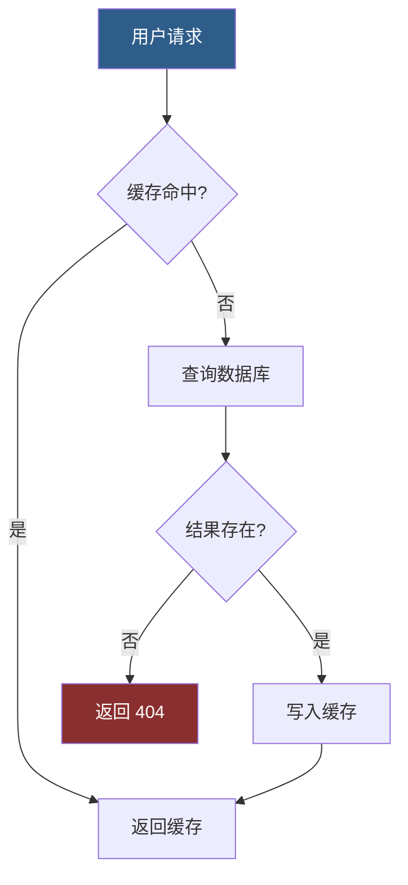
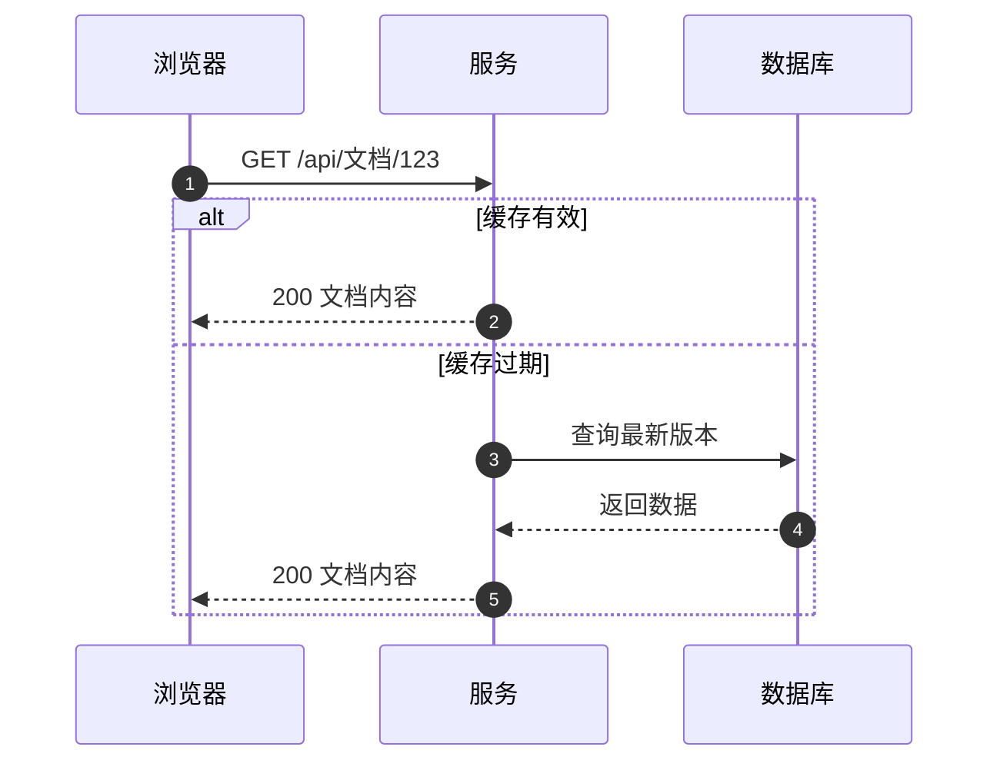
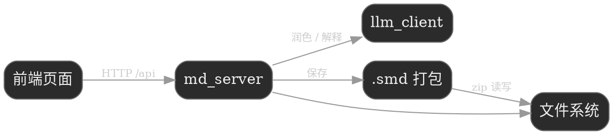

# MDEditor 使用指南

**本工具由 AI 辅助生成**：零依赖单文件 Markdown 编辑器，左侧写作、右侧实时渲染，全程本地运行。

## 基础语法

支持 *斜体*、**加粗**、~~删除线~~、`行内代码`，以及 [链接](https://example.com)。

> 引用块：把「>」放在行首。引用内部同样支持**加粗**等行内语法。

## 列表与任务

本工具的无序列表标记有独立语义（详见文末「语法速查与本工具的特殊写法」）：

`+` 渲染**实心圆点**，`-` 渲染**空心圆圈**，样式跟标记符走、与缩进无关（缩进只决定嵌套层级）：

+ 实心点列表项（加号）
- 空心圈列表项（减号）
  - 嵌套子项（缩进决定层级，样式仍跟自己的标记符走）

> 注意：**缩进嵌套子项是兼容语法**——仅为承接外部 Markdown（粘贴自 GitHub / Typora / AI 输出等）而保留，保证外部文档的多级列表不拍平。本工具自己表达层级退层的标准语法是 `<<<` 缩进包围块（见「缩进包围块」章节）：列表内部的层级细分、任意内容的整体缩进，都建议用 `<<<` 书写。

1. 有序列表项一
+ 单行回车不断序
  - 单行回车不断序
2. 有序列表项二（编号接力：显示编号由渲染器决定，输入数字只是标记）

- [x] 已完成任务
- [ ] 待办任务

> 注意：`*` 不作列表标记（`*星号*` 是斜体、`**双星**` 是加粗），行首 `* 内容` 会按普通段落处理。

## 代码块

```python
print("hello markdown")
```

## 表格

| 功能                                           | 状态 |
| -------------------------------------------- | -- |
| 实时预览                                         | 支持 |
| 导出 HTML / 分页 PDF                             | 支持 |
| 图片渲染（png/jpg/webp/gif）                       | 支持 |
| LaTeX 公式                                     | 支持 |
| Mermaid / Graphviz / WaveDrom / Vega-Lite 图表 | 支持 |

## 数学公式（KaTeX，本地渲染、离线可用）

行内公式：质能方程 $E=mc^2$，欧拉公式 $e^{i\pi}+1=0$。

块级公式：

$\int_a^b f(x)\,dx = F(b)-F(a)$

$\sum_{k=1}^{n} k = \frac{n(n+1)}{2}$

## 图表作图（四种，全部本地渲染、离线可用）

把代码块的语言标记写成对应引擎名，预览区会把它渲染成图，改左侧源码即实时重渲：

| 围栏                               | 引擎        | 擅长                   |
| -------------------------------- | --------- | -------------------- |
| ` ```mermaid `                   | Mermaid   | 流程图、时序图、状态机、甘特图、思维导图 |
| ` ```dot `（或 `graphviz` / `viz`） | Graphviz  | 复杂依赖拓扑，自动布局质量最高      |
| ` ```wavedrom `                  | WaveDrom  | 数字信号时序波形（协议握手、寄存器时序） |
| ` ```vega `                      | Vega-Lite | 数据图表（柱状、折线、散点等）      |

图表围栏同样支持**版面百分比宽度**：在语言标记后加 `{数字}`（如 ` ```mermaid {30} `），图宽 = 版面宽度的 30%、等比缩放，规矩与图片宽度参数完全一致（空格可省、`{150}` 钳到 100、非法值不生效且字面原样显示）；不带参数时维持默认行为（大图不超过版面宽，小图保持原始尺寸）。宽度参数只影响渲染，**不改任何源文件**。

### Mermaid：流程图（带判定分支与样式）



### Mermaid：时序图（编号消息 + 分支场景）



### Graphviz (DOT)：模块依赖拓扑



### WaveDrom：请求握手时序波形

```wavedrom{50}
{ "signal": [
  { "name": "clk",  "wave": "p......." },
  { "name": "req",  "wave": "01.0...." },
  { "name": "busy", "wave": "01......" },
  { "name": "data", "wave": "x345x...", "data": ["头部", "正文", "校验"] },
  { "name": "ack",  "wave": "0....10." }
]}
```

### Vega-Lite：数据柱状图

```vega{50}
{
  "$schema": "https://vega.github.io/schema/vega-lite/v5.json",
  "data": { "values": [
    {"day": "周一", "words": 1200}, {"day": "周二", "words": 1850},
    {"day": "周三", "words": 940},  {"day": "周四", "words": 2100},
    {"day": "周五", "words": 1560}, {"day": "周六", "words": 320},
    {"day": "周日", "words": 0}
  ]},
  "mark": "bar",
  "encoding": {
    "x": {"field": "day", "type": "nominal", "sort": null},
    "y": {"field": "words", "type": "quantitative", "title": "每日字数"}
  }
}
```

> 说明：四种图表引擎均为**按需懒加载**——文档里没有图就零开销，首次出现对应围栏才加载本地引擎；渲染失败时容器内原样显示源码与错误信息，不会吞错；暗色 / 亮色主题切换时已渲染的图会按新主题重绘。`wavedrom` 与 `vega` 围栏内必须是**严格 JSON**（不支持 JS 对象字面量的裸键名）。

## 图片

图片语法：``。下面这张图放在**同名资源目录**里，用相对路径引用——**`.md` 与 `.assets/` 是一对，一起拷贝即可完整迁移**：


网络图片写法相同，把括号内换成 https:// 图片网址即可（需联网）。

**本地图片**：直接复制一张图，在编辑区按 `Ctrl+V` 粘贴即可——编辑器会自动把它存到**同名资源目录**，并插入正确的相对引用，无需手写路径：

```
你的文档.md
你的文档.assets/          ← 图片都自动归到这里
    └ 20261014_235812_3421.png
```

文档里的引用形如 ``，与图片实际存放位置一致，预览即可显示。

> 提示：`Ctrl+V` 前请先保存文档（无文件路径时无法确定资源目录）。`.md` 与 `.assets` 目录是一对，一起拷贝给别人即可完整打开。

### 图片宽度参数 {N} 与对齐后缀 c / l / r

在图片引用后加 `{数字}`，这张图的宽度就 = **版面宽度的 N%**，高度等比缩放。基准是**版面**而不是原图：两张原图大小不同的图，只要参数相同，显示宽度就相同。下面是同一张图两次——第一次不带参数（大图按版面 100% 显示），第二次 `{40}`（版面的 40%）：


{50}

- 参数范围 1~100：`{150}` 按 100 处理；`{0}`、`{abc}` 等无效值不生效（后缀原样显示，便于发现笔误）
- **单图对齐后缀**：`{40c}` 居中 / `{40l}` 左 / `{40r}` 右（`{c}` 纯对齐也合法）——单图覆盖「排版」面板的图片全局对齐档；不带后缀时按面板全局档
- 网络图片与本地图片写法相同
- 分页导出时同样相对**页面版心**生效；超长图先按参数定宽，再按调整后的实际高度切片续排，条带保持同一宽度
- **原始图片文件只读不写**：参数只决定渲染与排版尺寸，预览、导出、分页切片（切片产生的是缓存副本）均不修改原图
- 图表围栏（mermaid / dot / wavedrom / vega）支持同一参数（含对齐后缀）：` ```mermaid {30r} `，规矩与此处完全一致

### 图片分栏 @@ fill

多张图（或图表）并排成行时用分栏语法包裹，比例 = 各栏占**版面宽度的百分比**（与 `{N}` 同口径）：

```
@@ begin fill {50|50}


@@ end fill
```

- 2~4 栏：`{50|50}`、`{30|30|40}`、`{25|25|25|25}`；**比例相加须 = 100**，否则整块按普通文本显示（fail-closed，便于发现笔误）
- **栏内容按空行分隔**：每栏 = 一段连续内容（一个图表围栏，或若干图片行）；段数必须等于栏数
- **栏内 `{N}` 失效**：宽度全权由栏比例决定（图等比缩入栏宽、小图保持原尺寸），写了也不生效
- 栏内容可以是图片与图表混合（` ```dot ` 围栏与 `` 混排）
- 预览 / 导出 HTML / 打印 / 导出 docx 同口径渲染（docx 以无边框表格作布局骨架）
- 未闭合（缺 `@@ end fill`）时整块按普通文本渲染

## 排版（工具栏「排版」按钮）

- 每种元素（正文 / H1 / H2 / H3~H6 / 引用 / 列表 / 表格 / 代码）可分别设置**字体、字号、对齐**；**图片**元素只有**对齐**档（图片无字体字号语义），单图可用 `{N c/l/r}` 后缀覆盖
- 对齐支持：默认 / 左 / **居中** / 右 / 两端
- 段落缩进按元素独立：**正文**提供首行缩进或悬挂缩进（字符数可调，随字号自动换算）；**列表**与**引用**各只有一个「**整体缩进**」档——整项 / 整块一起右移 N 字符，不再分首行与悬挂
- 「整体缩进」是容器级缩进：会被 `<<<` 缩进包围块的继承链使用（见下方「缩进包围块」）
- 列表整体缩进的落点经过实测校准：清零浏览器/主题自带的列表左内边距，改由外边距承载档位，并使用行内列表标记——**序号/圆点精确站在档位处**，不再有隐形底座；代价是多行列表项的续行**顶格**（与标记对齐）而非悬挂在外
- 排版等界面设置保存在**编辑器目录 `runtime/ui-settings.json`**（本机文件，跨重启保留；浏览器缓存仅作会话内副本）
- 表格样式：三线表、表头底色、首列底色（颜色可选）

## 缩进包围块 `<<< ... <<<`

**本工具表达"整体缩进"的标准语法。** 需要某几段（或一个列表）整体再缩进一层时，用 `<<<` 把它们包起来：

有如下几种形式：
<<<
正文模式
<<<
<<<
1. 第一项
2. 第二项
<<<
<<<
+ 再进一层
<<<

- 包围块的起始位置 = **上一段的缩进位置**：正文按其首行缩进档、列表/引用按其整体缩进档；上一个包围块渲染后的实际位置直接作为下一个包围的起点（连续紧邻即逐级递进，上例第二块 = 第一块位置再进一层）
- **空行、标题、围栏、表格等会打断继承**——隔了空行再写 `<<<`，从零基准重新起步（与列表编号接力的打断口径一致）
- 块内正文的首行缩进照常生效，但只影响自己；**继承链只走容器级缩进**（包围块、列表整体缩进、引用整体缩进）
- 开闭都是 `<<<`，不支持嵌套（块内再出现 `<<<` 即视为闭合）；未闭合时标记按普通文本原样显示（便于发现漏写）
- 标记行本身不显示；预览、导出、分页的缩进完全一致

## 保存与导出

- 编辑停顿即**存入浏览器缓存**，防丢稿
- 「排版」面板可设置**自动落盘间隔**（0~60 分钟），到点自动写回原文件
- 「保存」按钮立即写回原 .md 文件（**尚未另存为的新文档，「保存」不可用，请先「另存为」**；只有「另存为」会弹出选择窗口）
- 打开文档时若含 base64 内嵌图或本机绝对路径图，保存/另存**会自动把图片收进同名 `.assets/` 并把引用改写为相对路径**
- 导出三件套：**.md**（纯文本）、**.html**（带排版与公式）、**分页**（纸张 / 页边距 / 页码 / 自动目录，Ctrl+P 直接出 PDF）

## 分屏滚动联动

在分屏（左编辑器 / 右预览）模式下，**滚动左侧编辑区，右侧预览会自动跟随**到对应位置——这是**单向**联动，预览滚动不会回牵编辑区。

联动以**标题为硬锚**：编辑区滚到某个标题附近时，预览精确锁定到该标题；两个标题之间按滚动百分比平滑过渡。因此哪怕文档里夹着一张几十行的大表格，预览也能连续扫过、不跳段、不丢行。

跟随行为可用工具栏「**跟随**」开关随时切换：开了预览跟随编辑区滚动，关了则两侧各滚各的。开关状态会记住，重启后保持。

## 选区批注

选中正文任意片段，浮动工具条点「**备注**」即可加批注，被标注文字以**虚线 + 淡底色**呈现。

批注**跟文本走，不跟位置走**：前后插入、增删段落，标注随文字移动不丢失；片段被删光时该批注自动失效。点正文里的虚线段，可随时查看、编辑、删除，或让 **AI 解释**该片段。批注随文档保存——普通文档存于 `<文档名>.assets/annotations.json`，`.smd` 存于包内，整理（compact）时一并保留。

## AI 润色

选中片段，浮动工具条点「**润色**」，AI 改写结果先弹出**原文 / 新文对照**预览（新文还能先手动微调），点「**替换原文**」才写回——绝不未经确认直接改动你的文字。

AI 解释（批注弹窗内一键按钮）可请 AI 解读当前标注片段。两者依赖**本地 LLM**：在工具栏「**AI**」设置面板中配置后端（LM Studio 默认 `http://localhost:1234` 或 Ollama `http://localhost:11434`）、模型与参数，请求只发往你设置的本机地址，不经任何第三方。未配置或服务未启动时，批注等其余功能不受影响，仅润色与 AI 解释不可用。

## 语法速查与本工具的特殊写法

本工具**不是标准 Markdown 的照搬**，而是一套增强方言：标准语法之上加了一批自有写法，也有少数与社区惯例不同的地方。写文档时以下表为准：

### 与标准 Markdown 不同的地方

| 写法 | 本工具行为 | 标准社区惯例 |
| --- | --- | --- |
| `+` 无序列表 | 渲染**实心圆点** | 与 `-` 无区别 |
| `-` 无序列表 | 渲染**空心圆圈** | 与 `+` 无区别 |
| 无序标记与缩进的关系 | 样式跟标记符走，缩进只决定嵌套层级 | 空心圈通常是嵌套二级的默认外观 |
| 缩进嵌套子项 | **兼容语法**：仅承接外部 Markdown 粘贴，本工具层级表达的标准写法是 `<<<` 包围块 | 嵌套子列表是标准层级写法 |
| `*` 星号 | 只作行内斜体 / 加粗，**不作列表标记**（行首 `* 内容` 按普通段落） | `* 内容` 是合法无序列表 |
| 有序列表编号 | **编号接力**：显示编号 = 渲染器按区域顺序生成，输入数字只是标记（写 `5.` 也按顺序显示） | 显示编号 = `<ol start>` + 逐项递增 |

### 本工具特有的写法

| 写法 | 作用 | 详见 |
| --- | --- | --- |
| `{30}` | 图片宽度 = 版面宽度的 30%、等比缩放（基准是版面不是原图，不改原图文件） | 「图片 · 图片宽度参数」 |
| `{30c}` | 宽度 + 单图对齐（c 居中 / l 左 / r 右，覆盖排版面板图片全局档；`{c}` 纯对齐也合法） | 「图片 · 宽度参数与对齐」 |
| ` ```mermaid {30} ` 等图表围栏带 `{N}` | 图表宽度 = 版面宽度的 N%，规矩与图片 `{N}` 完全一致（空格可省、钳制 100、非法字面保留；对齐后缀同图） | 「图表作图」 |
| ` ```mermaid ` / ` ```dot ` / ` ```wavedrom ` / ` ```vega ` | 四种本地图表引擎围栏，离线渲染 | 「图表作图」 |
| `@@ begin fill {50\|50}` … `@@ end fill` | 图片/图表分栏并排（2~4 栏、比例为版面宽度百分比、相加须 =100；栏内 `{N}` 失效；docx 以无边框表格渲染） | 「图片 · 分栏」 |
| ` ```mermaid ` / ` ```dot ` / ` ```wavedrom ` / ` ```vega ` | 四种本地图表引擎围栏，离线渲染 | 「图表作图」 |
| `- [x]` / `- [ ]` | 任务列表（可勾选样式的待办项） | 「列表与任务」 |
| `~~文字~~` | 删除线 | 「基础语法」 |
| `$...$` / `$$...$$` | 行内 / 块级 LaTeX 公式 | 「数学公式」 |
| `<<< ... <<<` | 缩进包围块：块内容以上一段的缩进位置为起点整体右移；紧邻连续块逐级递进，空行/其他块打断 | 「排版 · 缩进包围块」 |

### 约定

- `\X`（X 为标点）：反斜杠转义，显示字面字符（防止标点被当作语法解析）；代码段内反斜杠保持字面
- 所有 `{N}` 类参数：数字为**版面百分比**，范围 1~100（超出钳到 100），非法值不生效且字面原样显示（便于发现笔误）
- 图表围栏内 `wavedrom` / `vega` 必须是**严格 JSON**（不支持 JS 对象字面量的裸键名）
- 原始文件（图片等）永远只读：任何参数与导出排版都**不修改文件本体**

## 离线可用

公式渲染（KaTeX）、分页引擎（Paged.js）与四种图表引擎（Mermaid / Graphviz / WaveDrom / Vega-Lite）均已本地部署，**断网不影响任何功能**；仅内容中的网络图片与链接需要联网。


---

试着修改左侧内容，右侧会实时更新。
