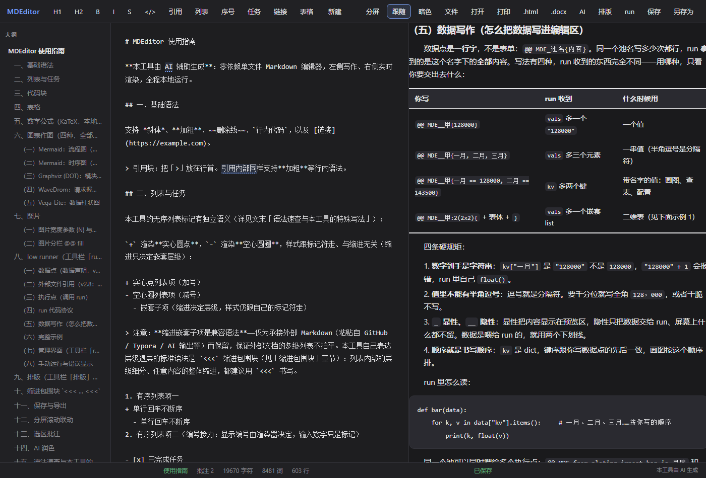
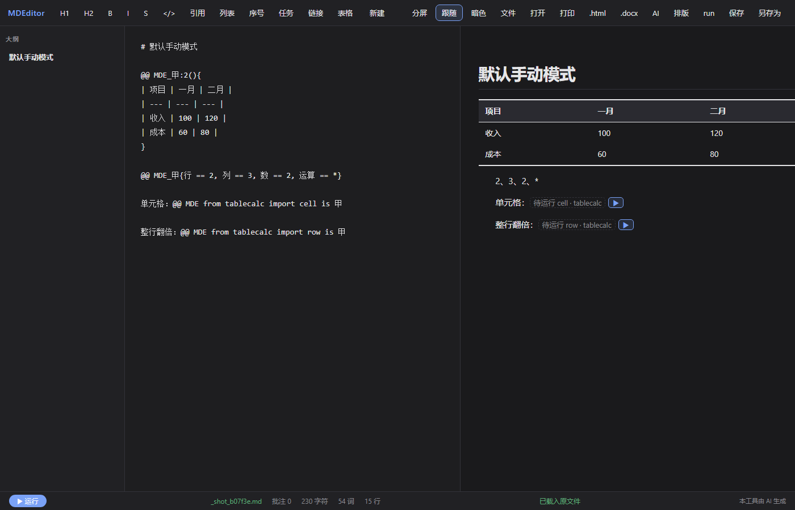
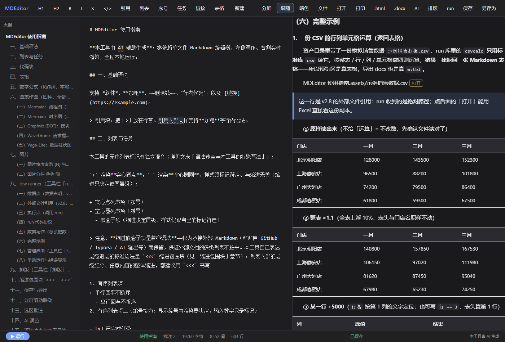
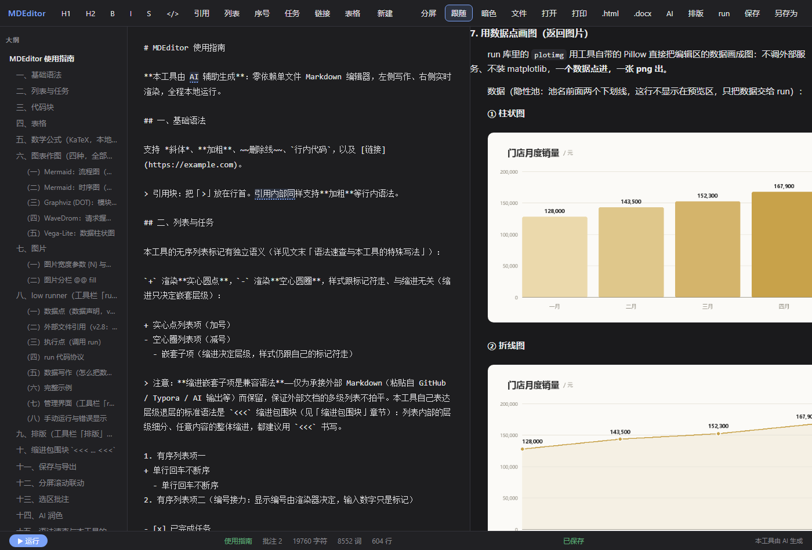
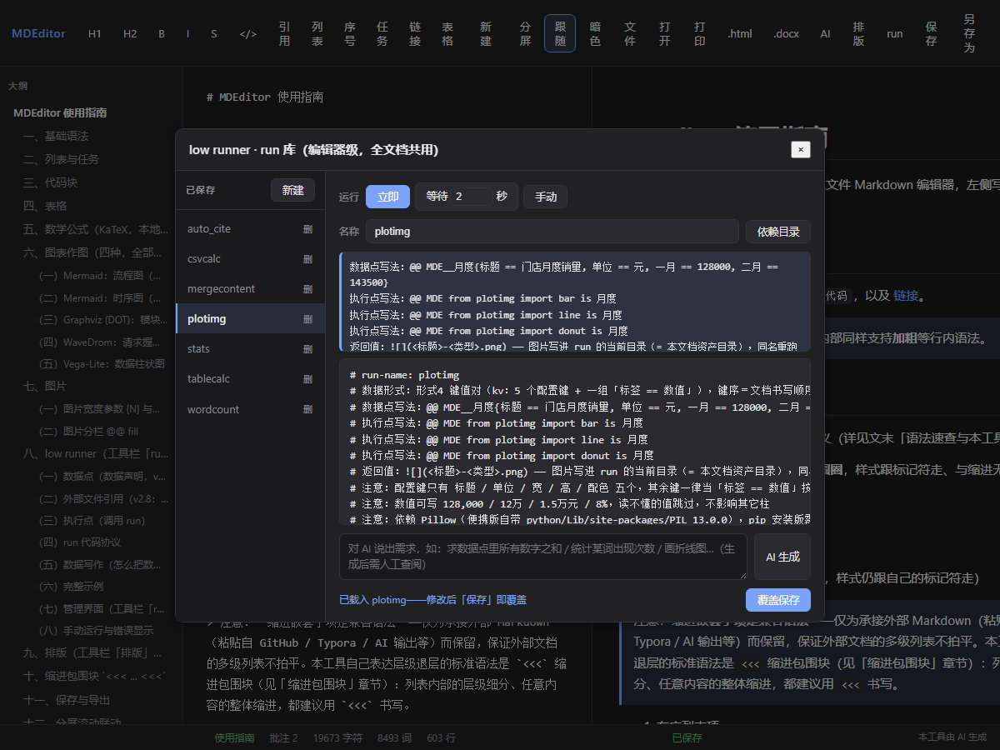

# MDEditor 2.8：在文档里跑自己的代码



Markdown 编辑器大多停在"写"和"看"两件事上：左边敲字，右边出排版。写到需要算一下的时候——把一张表里的数字翻一倍、把一段文本按字数统计、按数据画一张图——只能切出去，Excel、脚本、画图工具轮一遍，再把结果贴回来。贴回来的是死数字，源数据一改，全部重来。

MDEditor 从 2.5 起做了一件不太一样的事：**文档里除了文字，还可以有"数据点"和"执行点"**。数据点写数据，执行点写"调用哪个函数、吃哪份数据"。执行的那一刻，函数返回什么，文档里就显示什么。返回一张表格，就是真表格；返回一张图片，就是真图片。

这一版（2.8）补上了这条路线上缺的两块：**外部文件可以直接引用**，**图片有了明确的落点**。同时把执行时机从"打开就跑"改成"你点它才跑"。

---

## 一、这一版修了什么

从 2.6.13 到 2.8.1，改动分四类。每一条都是实际跑出来的问题，不是规划。

### 1.1 结果显示得对不对

| 症状 | 根因 | 现在的行为 |
|---|---|---|
| 表格型执行点返回 `"\|a\|b\|\n\|---\|---\|\n\|1\|2\|"`，显示成一坨文本 | 结果区走了独立的渲染路径，没识别表格语法 | 命中「本行含 `\|` 且下一行是分隔行」就按表格渲染，分隔行只定列数与对齐、自身不显示 |
| 单元格里的斜体、行内码不生效 | 结果区只做纯文本转义 | 结果按块级最小集渲染，行内语法正常 |
| 单行结果也被塞进 `<p>` 变成独立段落 | 无差别包块 | 单行 `str` 就在执行点原位行内显示 |

### 1.2 外部文件能不能用

| 症状 | 根因 | 现在的行为 |
|---|---|---|
| `Ctrl+V` 粘一个 `.xlsx`／`.pdf`／`.csv`，毫无反应 | 粘贴监听只认 `type` 以 `image` 开头的项，其余落到文本兜底被静默丢弃 | 粘贴监听新增文件分支：落盘到文档资产目录、在光标处插入一行数据点、路径继承最近的池前缀，不弹框 |
| 数据点里写了相对路径，`run` 里 `open()` 读不到 | 子进程当前目录是 `runtime/run_cache`，与文档无关 | 子进程当前目录改为文档资产目录；`kv`／`vals`／`raw` 里的资产相对路径在传给 run 之前就展开成绝对路径 |
| 文件改了，文档里还是旧数 | 会话缓存只在块重建时把上次结果贴回，不清就贴旧值 | 点显性数据点旁的「打开」用系统程序打开文件，回来后该池所有执行点复位成「待运行」并删掉缓存项 |

### 1.3 图片落在哪

| 症状 | 根因 | 现在的行为 |
|---|---|---|
| `save('assets/x.png')` 再返回 ``，预览正常，文档目录里却没有文件 | 子进程当前目录是缓存目录，图片落在缓存里 | 当前目录就是文档资产目录，写这里就等于写在文档旁边 |
| 返回 `` 反而 404 | 浏览器把相对路径解析到站点根 | 结果图片按「资产目录 → 文档目录 → 缓存目录」三个基址依次查找，命中就转成图片代理地址 |
| 文档名带空格时，显性数据点的「打开」按钮永不出现 | 判定里用 `\s` 一律排除，而 `MDEditor 使用指南.assets/x.csv` 天然带空格 | 只排除换行与制表符 |

### 1.4 什么时候执行

| 症状 | 根因 | 现在的行为 |
|---|---|---|
| 打开文档就自己开始跑，一边打字一边反复重跑 | 运行模式的兜底默认值是「立即」（渲染后 0.4 秒自动执行） | **默认改为「手动」**：只把执行点标成「▶ 待运行」，点它或左下角「运行」才跑。想自动跑，在 `run → 运行模式` 里点「立即」或「等待 N 秒」，选一次就记住 |

---

## 二、工具现在能做什么

先给全景，再讲 low runner。

- **写与看**：左编辑右预览，即写即见。KaTeX 本地渲染公式，四种图表（Mermaid、Graphviz、WaveDrom、Vega-Lite）写在围栏里就出图，断网可用。
- **排版**：字体、字号、对齐按元素（正文／各级标题／引用／代码／表格／公式）分开设置，改一次整篇同步，导出跟着变。
- **长文档**：按章节分块渲染，只重绘变化的那一块；分屏滚动以标题为硬锚联动。
- **导出**：`.docx`、独立 HTML、分页 HTML、打印，导出的成品不含执行点按钮与内部标记。
- **批注与 AI**：选中文字挂批注，标注跟文字走；接本地或远程模型做润色，改之前先给你看。
- **low runner**：文档里写数据点，执行点上调用自己写的 Python 函数，返回值就地渲染成文本、表格或图片。
- **本地优先**：数据不出本机，不依赖云服务；关掉程序就走，不留后台。



默认手动态：两个执行点都停在「待运行 ▶」，左下角有「运行」。不点，它不动。

---

## 三、low runner 是什么

两个角色，两种写法：

- **数据点** —— 提供数据。写法 `@@ MDE_池名{...}`。
- **执行点** —— 调用函数。写法 `@@ MDE import 库名 is 池名` 或 `@@ MDE from 库名 import 函数名 is 池名`。

`库名` 就是 `runtime/runs/` 目录下的文件名（不带 `.py`）。`is 池名` 表示这个执行点只吃这个池的数据；不写 `is` 就吃公共池。

最小可跑的例子：

```
@@ MDE_水果{苹果 == 3, 梨 == 2}

合计：@@ MDE import 水果统计 is 水果
```

`runtime/runs/水果统计.py`：

```python
def run(data):
    total = sum(int(v) for v in data['kv'].values())
    return '一共 %d 个' % total
```

预览区「合计：」后面显示「一共 5 个」。改数据点里的 `3` 为 `30`，执行点重新跑一次，结果跟着变。

---

## 四、输入：run 收到的 `data` 长什么样

这是最容易写错的地方，所以逐项写死。

### 4.1 只有四个键

```python
data['kv']      # dict[str, str]      名字 → 值。数字也是字符串。
data['vals']    # list[...]           一个装着"不同形状"的容器，见 4.2
data['raw']     # list[str]           数据点原文（含 == 与 (( )) 等语法字符）
data['marks']   # list[dict]          只有 global 执行点才有：{'mark':名, 'ctx':所在段落}
```

三条硬规矩：

1. **`kv` 的值是字符串**。`苹果 == 3` 拿到的是 `"3"`，不是 `3`。要算就自己 `int()`。
2. **`vals` 是"装着不同形状的容器"，不是"一串值"本身**。每个元素都要先判形状：

```python
for item in data['vals']:
    if isinstance(item, list):          # 向量或表格
        for row in item:
            if isinstance(row, list):   # 二维表的行
                ...
```

直接把整个 `vals` 当 `list[str]` 用（`','.join(data['vals'])`、`sum(data['vals'])`）会当场 `TypeError`。

3. **`raw` 是原文备份，不是正文**。它带着 `==`、`(( ))`、`|` 这些语法字符，不能直接当文字展示。

### 4.2 `vals` 的四种形状

| 形状 | 来自哪种写法 | 代码里的样子 |
|---|---|---|
| `str` | 一段文字 | `"今天买了苹果"` |
| `list[str]` | 一串值 | `["3", "4", "5"]` |
| `list[list[str]]` | 二维表 | `[["tony","59"], ["lily","18"]]` |
| `list[list[list[str]]]` | 三维表（多张二维表） | `[[[...],[...]], [[...]]]` |

四种形状**可以混在同一个 `list` 里**，元素按它们在文档里出现的顺序排列。

### 4.3 六种数据点写法

| # | 写法 | 屏幕上显示 | `data` 里产生 |
|---|---|---|---|
| 1 | `@@ MDE_甲{今天买了苹果}` | 原文 | `vals += "今天买了苹果"` |
| 2 | `@@ MDE_甲{苹果 == 3}` | `3` | `kv["苹果"] = "3"` |
| 3 | `@@ MDE_甲{3,4,5}` | 原文 | `vals += ["3","4","5"]` |
| 4 | `@@ MDE_甲{A == 3, B == 4}` | `3、4` | `kv` 合并 `{"A":"3","B":"4"}` |
| 5 | `@@ MDE_甲{…上涨((8%))，同比((1.5%))}` | 去掉 `(())` 的句子 | `vals += ["8%","1.5%"]` |
| 6 | `@@ MDE_甲:2(){ 表格行 }` | 渲染成真表格 | `vals += [["tony","59"],["lily","18"]]` |

三维表写 `:3()`，多张二维表之间用空行分隔。

解释这六种形式时必须知道的规则：

- **半角逗号 `,` 是向量分隔符**；全角 `，` 与顿号 `、` 是普通字。值里想出现半角逗号，这个数据点就写不成向量——换成表格。
- **坐标 `(rxc)` 是 1-based 起点**，`()` 表示全表。表头下面那行 `|:-|:-|` 是结构行，不计入坐标、也不进数据。坐标的用途是**避让表头与列标题**——从第 2 行第 2 列起取，等于跳过表头和第一列标签。
- **一个数据点的 body 只有一行时**按上面语法解析；**body 跨行时**一律当整段文字（形式 1）。
- **语法不合规是静默失效**：直写与 `(())` 混用、`((` 未闭合、坐标越界、键值段缺 `==`、`:2` 里放多张表——整个数据点按普通文字显示，不产生任何数据。代码只能在运行时通过"没收到数据"发现。
- **池名三种**：`@@ MDE_甲` 显性（显示值，喂 `is 甲` 的执行点）；`@@ MDE__甲` 隐性（屏幕不显示，只供数据）；`@@ MDE_` 公共池（喂没有 `is` 的执行点）。
- **同一个池名可以写多行数据点**，自动合并进同一个 `data`。
- **`kv` 同名键后写的覆盖先写的**，所以一组键值对里名字必须各不相同。

### 4.4 外部文件引用（2.8 新增）

把 `.xlsx`／`.pdf`／`.csv`／任何文件从资源管理器复制，在编辑区 `Ctrl+V`：

1. 文件被复制到**本文档的资产目录**，保留原文件名。
2. 光标处插入一行数据点，路径写成 `<文档名>.assets/文件名`。
3. run 收到的 `data['kv']` 里，这个值**已经是绝对路径**，直接 `open(值, 'rb')`。

三条边界：

- **复制一次就断链**。原文件后来改了，这边不会跟着变——想更新就再粘一次（同名同内容就复用原来那一个、不新增文件；同名不同内容会被存成 `文件名__<4位哈希>.ext`，绝不覆盖旧的）。
- **框架不解析任何文件**。xlsx 怎么读、pdf 怎么抽字，全部由 run 自己决定，只用标准库或你自己装的包。
- **单文件 20MB 上限**。

---

## 五、输出：返回给前端必须怎么写

这一章是本篇的重点。规则不多，但每一条都对应一个实际会踩的坑。

### 5.1 四种返回形状

| 返回什么 | 前端怎么显示 |
|---|---|
| 单行 `str` | 行内文本（粗体、行内码、链接可用），就在执行点原位 |
| 多行 `str`（字符串里带真换行 `\n`） | 逐行显示 |
| 表格 | 字符串里写出**表头行 + 分隔行 + 数据行**，渲染成真表格 |
| 图片 | 返回 `` |

`list`（非 global 执行点）会被逐元素 `str()` 后用逗号连成一行。

**返回值必须显式转成 `str`**。numpy 数值、`None`、`dict` 都要转，否则显示不可控。框架只保证：`str` 原样、`list` 逐元素转字符串，其他类型一律 `str()` 兜底。

### 5.2 表格：必须自己拼字符串

前端**不会**替你把二维数据变成表格。表格的唯一来源是"你返回的字符串长这样"：

```python
def run(data):
    return ("|项目|一月|二月|\n"
            "|---|---|---|\n"
            "|收入|100|120|\n"
            "|成本|60|80|")
```

三条要求：

1. **表头行 + 分隔行 + 数据行，一个不能少**。缺分隔行，前端不认表格，整段原样当文字——这是最常见的"为什么我的表格不出来"。
2. **分隔行只定列数与对齐，本身不显示**。`|---|---|`、`|:---|:---:|---:|` 都行。
3. **单元格里的竖线写成 `\|`**；单元格内不能换行、不能合并单元格。

已经踩过的坑：`str.format()` 和 f-string 里的花括号要双写（`{{ }}`），或者改用 `%`／字符串拼接。`'^{[{}]}'.format(1)` 会直接抛 `'int' object is not subscriptable`。



读一张 CSV，整表做四则运算，逐行返回 Markdown 表格字符串。

### 5.3 图片：写到哪个文件夹，返回什么

这一节是死规矩，没有例外。

#### 一、写到哪

**写到当前目录即可。run 的当前目录（`cwd`）就是本文档的资产目录。**

| 文档类型 | 资产目录 |
|---|---|
| `.md` | 与文档同级、名为 `<文档名>.assets` 的文件夹 |
| `.smd` | 包解开后的 `assets/` 目录 |

也就是说：

```python
def run(data):
    from PIL import Image, ImageDraw
    img = Image.new('RGB', (400, 240), 'white')
    ImageDraw.Draw(img).text((20, 20), 'hello', fill='black')
    img.save('销量图.png')            # 就写在当前目录，不用拼任何路径
    return ''          # 名字必须和上面那个字符串一字不差
```

文档没保存（新建、还没另存为）时，当前目录回落到 `runtime/run_cache`——这是旧行为，为了让你先跑得起来；一旦另存为，落点就变成文档资产目录。

#### 二、返回什么

**返回 ``，文件名与上面 `save()` 的字符串逐字相同。**

| 返回写法 | 结果 |
|---|---|
| `` | 正确。按三个基址依次找文件，命中后转成图片代理地址显示 |
| `` | 可以，但**子目录要先自己建**（`os.makedirs('子目录', exist_ok=True)`），否则 `save()` 直接抛异常 |
| `` | **会挂**。不会被识别为绝对路径，会被拼到资产目录下找不到，原样输出到浏览器再 404 |
| `` | 技术上能显示，但绕过了文档绑定，文档搬走就断图。不推荐 |
| `` | 能显示，但图片没落盘，文档一搬走就丢。不推荐 |

#### 三、文件名一致性的边界

这是最容易含糊的一条，说死：

- **写入名与返回名必须逐字相同**，包括扩展名。`save('销量图.png')` 就必须返回 ``，写成 `` 在 Windows 上碰巧能找到（文件系统不区分大小写），但这是在赌，别赌。
- **同名重跑 = 覆盖**。同一个执行点跑第二次，文件被覆盖，不产生 `销量图(1).png` 这种副本。想保留历史就自己在文件名里加时间戳或序号。
- **中文名可以**。图片地址走 URL 编码，中文、空格、括号都能显示。但**名字里别出现 `)`**——Markdown 图片语法的右括号会提前结束地址。
- **文件名不能带路径分隔符以外的花活**：`\` 在 Windows 上会被当分隔符，其它平台的规则不保证；用正斜杠 `/` 或干脆不写子目录。
- **同一个名字别在两个执行点里混用**。它们会互相覆盖，且谁后跑谁说话。



同一个隐性数据池，分别喂柱状图、折线图、圆环图三个执行点，各出一张图，都落在本文档资产目录。

### 5.4 global 执行点

写法 `@@ MDE from 库名 import 函数名{global 标记名}`，用于"正文里每个标记都要换一遍"的场景（自动编号、自动脚注）。

- 正文里写 `'''标记名`，框架全文扫描它出现的每一处，按顺序放进 `data['marks']`。
- 函数**必须返回 `list[str]`**，长度等于 `len(data['marks'])`。少一个即整点失败，标记保持原文。
- 替换只做一轮：替换文本里再出现 `'''标记名` 不会二次展开。

### 5.5 其他硬约束

- 禁 `input()`／`sys.stdin`（子进程无人按键，当场 EOF）。
- 禁 `print`：标准输出被框架独占，用来传结果。
- **执行超时 10 秒**，**返回内容上限 1MB**。超过直接报错，不是截断。
- 一个操作一个顶层 `def`，`run(data)` 只做汇总；不要加参数开关。

---

## 六、解释器：在哪改

工具自带一个便携 Python，run 就跑在它上面。默认是 **Python 3.11.9**，自带 `Pillow`、`pythonnet`、`bottle`、`webview` 等组件（第三方组件的许可声明随安装包提供）。

改解释器只需动 `md_server.py` 一行：

```python
# md_server.py:77
PORTABLE_PY = os.path.join(HERE, "python", "python.exe")
```

真正决定"用哪个解释器跑 run"的是这一句：

```python
# md_server.py:722（_lr_run 内）
py = PORTABLE_PY if os.path.exists(PORTABLE_PY) else sys.executable
```

意思是：**装目录下存在 `python/python.exe` 就用它；不存在，回落到启动本服务的那一个 Python**。

同一份代码里还有一处同样的表达式，那是「run 保存时的依赖检测」（`md_server.py:535`），用来判断你 import 的三方包在不在。**换解释器时这一处必须一起改**，否则会出现"检测说有包、实际跑起来没有"。

`sys.executable` 的回落路径意味着：用 `pip install markdowneditor` 的方式装在系统 Python 里跑时，run 用的是系统解释器，此时它没有便携版自带的那些包——需要自己装（见下一节）。

---

## 七、三方包：放到哪个文件夹

**放到 `<安装目录>/runtime/pylibs/`。**

为什么不是 `pip install` 到全局：

1. 便携解释器不是系统注册的解释器，`pip` 装到的是别的地方。
2. 装进 `runtime/pylibs`，卸载程序时一起清掉，不污染机器。

注入是两处，都在 `md_server.py`：

```python
# md_server.py:75
PYLIBS_DIR = os.path.join(HERE, "runtime", "pylibs")

# md_server.py:745（子进程环境变量）
env["PYTHONPATH"] = PYLIBS_DIR if os.path.isdir(PYLIBS_DIR) else ""
```

```python
# md_server.py:573-574（子进程驱动代码里，双保险）
sys.path.insert(0, RUNS_DIR)
sys.path.insert(0, PYLIBS_DIR)
```

装法（用任意一个装了 pip 的 Python 执行）：

```
pip install --target "<安装目录>/runtime/pylibs" 包名
```

要点：

- **必须带 `--target`**，指向那个目录，否则装到默认位置等于没装。
- **版本的 ABI 要对**。解释器是 3.11，编译型包（`.pyd`）必须是 `cp311` 对应版本；纯 Python 包无所谓。
- **装完不需要重启**。`PYTHONPATH` 每次执行 run 时重新读。
- **保存 run 时会自动做依赖检测**：代码里 import 的包在执行环境缺哪个，面板红色列出并给出上面的安装命令。
- 分发到别的机器时，`runtime/pylibs` 整个目录跟着走。

---

## 八、文件名与路径：一张汇总表

| 对象 | 规则 | 谁定的 |
|---|---|---|
| run 库文件名 | 字母／数字／下划线／连字符／点／中文，不能含 `/` `\` `..` | `md_server.py:459` `_lr_valid_name` |
| 执行点里写的库名 | 不含 `.py`，与文件名主干一致 | 同上 |
| 资产目录 | `.md` → `<文档名>.assets/`；`.smd` → `assets/` | `md_server.py:612` `_doc_assets_dir` |
| run 写出的图片 | 写在当前目录（= 资产目录），返回名与写入名逐字相同 | `md_server.py:722` + `_lr_rewrite_imgs` |
| 粘贴进来的外部文件 | 保留原名；同名同内容复用；同名不同内容加 `__<4位哈希>`；上限 20MB | `md_server.py:1793` |
| 文件名清洗 | 去掉路径、把 `,` `=` `{` `}` 与换行替换为 `_`、长度截断到 120 | `md_server.py:673` `_safe_asset_name` |

文件名清洗这条值得单说：数据点的键值语法用 `,` `=` `{` `}` 做分隔符，文件名里出现这些字符会把 `@@ MDE_甲{表 == xxx, 列 == 一月}` 这一行解析错，所以粘贴时会替换成下划线。

---

## 九、常见错误对照表

| 现象 | 根因 | 改法 |
|---|---|---|
| 执行点一直显示「▶ 待运行」 | 默认手动模式，没触发 | 点执行点旁的 ▶，或左下角「运行」 |
| 表格显示成一坨带竖线的文字 | 返回值缺分隔行 | 补 `\|---\|---\|`，或表头与数据之间那一行 |
| 图片显示不出来，预览里是个破图标 | 返回的是绝对路径，或名字与写入的不一致 | 返回相对文件名，与 `save()` 的字符串逐字对齐 |
| `open(data['kv']['表'])` 报文件不存在 | 值不是绝对路径（手写的数据点），或文件没在资产目录里 | 用粘贴引用让框架展开成绝对路径；或自己在 run 里按 `cwd` 拼 |
| run 报「输出非 JSON」 | 代码里有 `print`，污染了标准输出 | 删掉 `print`，结果用 `return` |
| run 报「执行超时（>10s）」 | 计算太重或卡在输入上 | 拆小、加缓存、别用 `input()` |
| 改了数据点但结果没变 | 会话缓存贴回了旧值 | 改数据点会改变数据指纹，正常会自动重算；若走的是「打开外部文件」路径，点一次「打开」即复位 |
| 依赖检测说缺包，但 `import` 能过 | 换解释器时只改了 `md_server.py:722`，没改 `:535` | 两处一起改 |

---

## 十、边界：这一版没做什么

说清楚比说漂亮重要。

- **框架不解析任何文件**。xlsx／pdf／csv 怎么读，由 run 自己决定。因此"引用一个 Excel 就能自动算"这件事，前提是你有一个会读 Excel 的 run。
- **不做原文件同步**。复制进资产目录就是副本，与源文件断链。不记录来源路径，不做变更监听。
- **不做远程引用**。只认本地文件。
- **不新增第七种数据形式**。六种写法就是全部。
- **不做图片生成**。run 返回什么图就显示什么图，框架不替任何人画图。
- **不做并行执行**。执行点按文档顺序串行，一个跑完再跑下一个。

---

## 附：两处能省一半调试时间的做法

1. **先在 `run` 面板里跑通代码，再写进文档**。面板里选择 run 库、改代码、保存即入库，保存时会做依赖检测和语法检查。
2. **看用法说明，不要看文件头**。run 面板上方会把你写在文件头的四类注释（`# 数据点写法：`／`# 执行点写法：`／`# 返回值：`／`# 注意：`）抽出来单独显示，照着写数据点就不会错。


