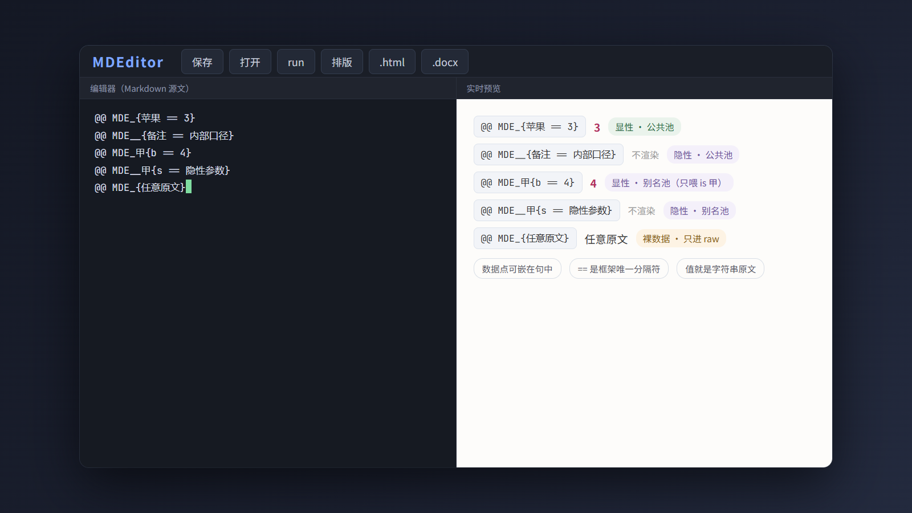
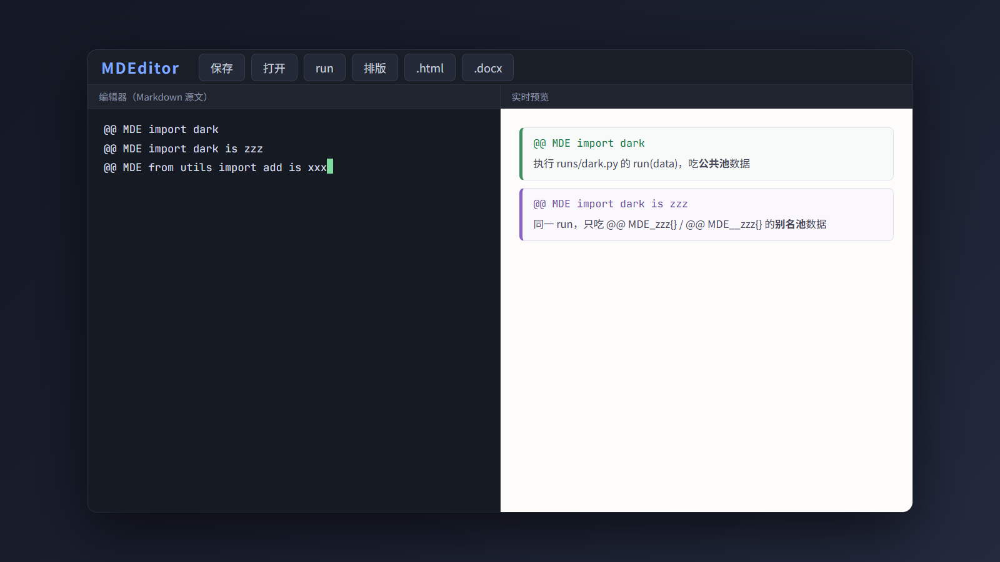
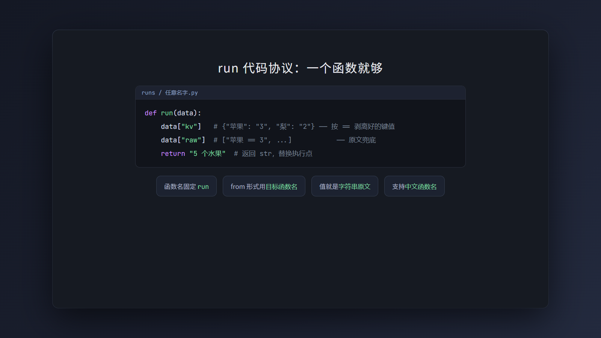
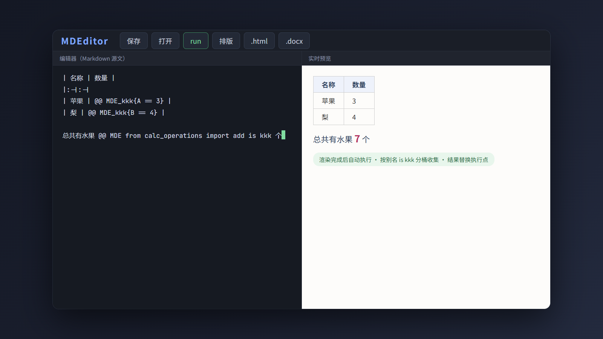
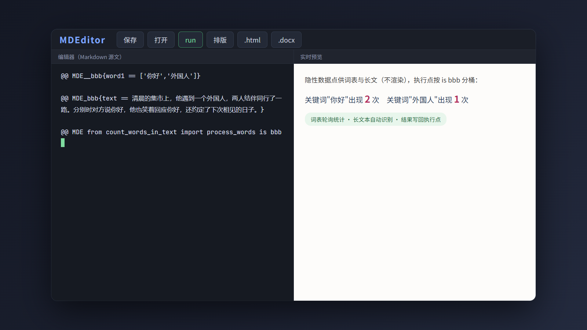
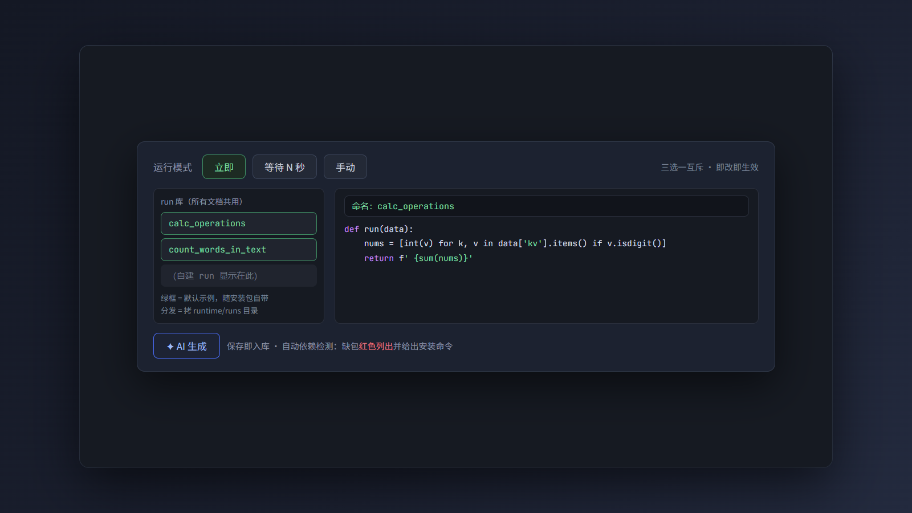
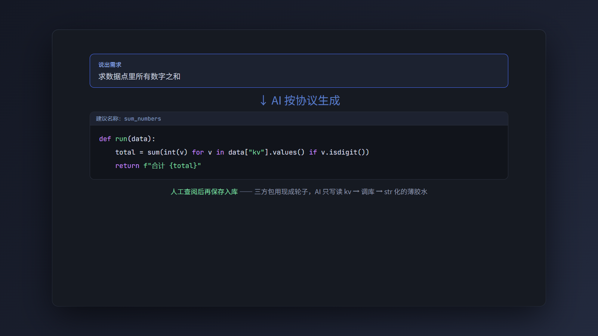
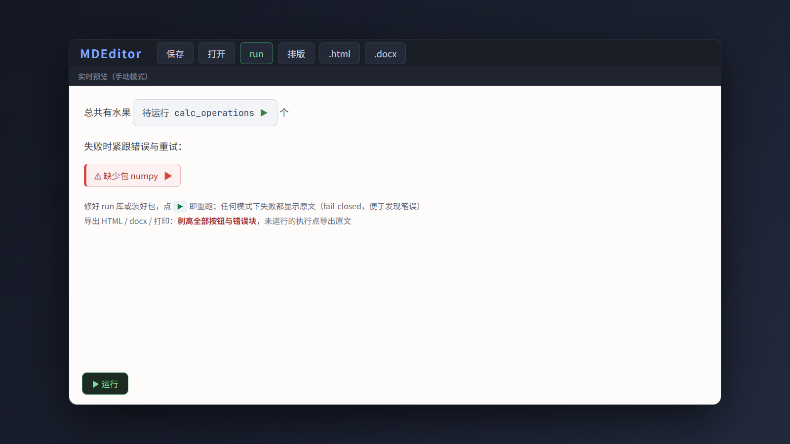
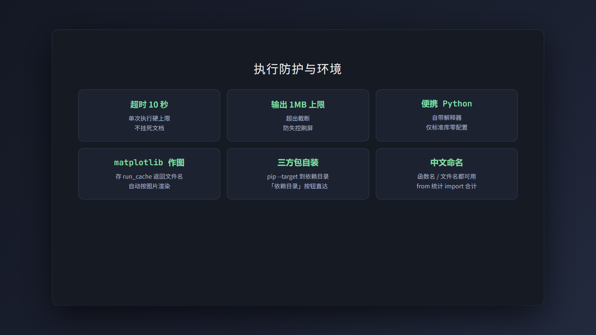

# MDEditor low runner：文档内数据自动化计算


low runner 是 MDEditor 的文档内代码运行功能（工具栏「run」按钮）：在写作中声明**数据点**，再调用 Python run（自己写或 AI 生成）对全文数据做计算、合并、筛选、统计、画图。文档数据的自动化加工，留在文档内完成，不做系统级功能。这篇文档对应宣传视频，逐节讲解它的用法。

## 工作流总览


一条流水线，全程在文档里：

1. **声明数据点**——写作中随手写，显性显示、隐性供数；
2. **按别名分桶**——公共池 / 别名池，谁的数据谁明确；
3. **调 Python run**——run 库或 AI 生成，便携解释器执行；
4. **结果替换**——返回字符串，写回执行点位置。

## 数据点（数据声明）



数据点写法五种：

| 写法 | 渲染 | 说明 |
| --- | --- | --- |
| `@@ MDE_{苹果 == 3}` | 显示 `3` | 显性·**公共池**：`==` 后的值；`键/值` 进 kv |
| `@@ MDE__{备注 == 内部口径}` | **不渲染** | 隐性·**公共池**：只为 run 提供数据 |
| `@@ MDE_甲{b == 4}` | 显示 `4` | 显性·**别名池**：只喂给 `is 甲` 的执行点 |
| `@@ MDE__甲{s == 隐性参数}` | **不渲染** | 隐性·别名池 |
| `@@ MDE_{任意原文}` | 显示原文 | 裸数据：只进 raw |

- 数据点可嵌在句中（"买了苹果 @@ MDE_{苹果 == 3} 个"），长内容可跨行（`{` 后换行、`}` 收尾）；
- `==` 是框架唯一认的分隔符（第一个 `==` 切分、两侧去空白）；其他约定（`:`、`=` 等）代码里用 raw 自己剥；
- **值就是字符串原文**——写 `["词1","词2"]` 也原样传递（代码里 `json.loads` 解析轮询列表等结构，框架不预设值的形态）。

## 执行点（调用 run）



执行点一行调用，三种形式：

```
@@ MDE import dark                      → 执行 runs/dark.py 的 run(data)，吃公共池
@@ MDE import dark is zzz               → 同一 run，只吃别名池 zzz 的数据
@@ MDE from utils import add is xxx     → 执行 utils.py 的 add(data)，只吃 is xxx 池
```

- **别名规则统一**：`import` 与 `from import` 都支持 `is`，无 `is` 一律公共池——同一 run 多处调用时用 `is` 区分各处数据（谁的数据谁明确）；
- 渲染完成后自动执行：按别名分桶收集数据点，每个执行点吃自己桶的数据（公共池/别名池位置无关），各自调 run，结果替换执行点；
- run 失败/不存在：执行点显示原文（**fail-closed**，便于发现笔误）；
- 会话内结果缓存（数据不变不重跑）；run 库保存/删除后自动清缓存重跑。

## run 代码协议



一个函数就够：

```python
def run(data):          # 函数名固定 run（from 形式则用目标函数名）
    data["kv"]          # {"苹果": "3", "梨": "2"} —— 框架按 == 剥离好的
    data["raw"]         # ["苹果 == 3", "备注 == 内部口径", ...] —— 原文兜底
    return "5 个水果"    # 返回 str 替换执行点
```

值就是字符串原文；支持中文函数名/文件名（`@@ MDE from 统计 import 合计`）。

## 默认示例一：四则运算



随包自带的 `calc_operations` 演示端到端流程——表格里声明数据，正文一句话调用：

```
| 名称 | 数量 |
|:-|:-|
| 苹果 | @@ MDE_kkk{A == 3} |
| 梨   | @@ MDE_kkk{B == 4} |

总共有水果 @@ MDE from calc_operations import add is kkk 个
```

渲染完成后自动执行：`add` 按 `is kkk` 吃到 A=3、B=4，求和得 **7**，结果替换执行点，全程无需手动操作。

## 默认示例二：词频统计



`count_words_in_text` 演示隐性数据点 + 轮询统计：词表和长文都写成数据点（不渲染），run 自动识别长文本（>50 字）、解析列表字面量，逐词统计出现次数并写回执行点：

```
@@ MDE__bbb{word1 == ['你好','外国人']}

@@ MDE_bbb{text == ……长文……}

@@ MDE from count_words_in_text import process_words is bbb
```

## 管理界面（工具栏「run」）



- 顶部**运行模式**（三选一互斥，即改即生效）：**立即**（渲染后 0.4 秒自动跑）/ **等待 N 秒**（停止输入 N 秒后跑，N 自己填，默认 5）/ **手动**（不自动跑）；
- 左侧 run 库列表（编辑器级统一管理，**所有文档共用**；分发 = 拷 `runtime/runs` 目录）；
- 右侧命名框 + 代码框；保存即入库（名字即 `@@ MDE import` 的名字）；**保存后自动做依赖检测**——引用的三方包在执行环境缺哪个，红色列出并给出安装命令（`pip install --target "...runtime/pylibs" 包名`；编译型包需 cp311 版本）；
- 随包自带五个示例（`stats` / `wordcount` / `mergecontent` / `auto_cite` / `tablecalc`，装后位于 `runtime/runs/`）；升级覆盖语义 = 示例重置，自建 run 不受影响。

## AI 生成



不会写代码也没关系：管理界面底部「AI 生成」说出需求（如"求数据点里所有数字之和"），AI 按协议生成代码并建议名称——**人工查阅后再保存入库**。三方包用现成轮子（numpy 等）= AI 生成薄胶水（读 kv → 调库 → str 化），核心计算 100% 是轮子的。

## 手动运行与错误显示



- **手动模式**：执行点渲染为「待运行 ×× ▶」——点 ▶ 单独运行该点；界面**左下角**「▶ 运行」按钮一次跑全部未执行的执行点（链式逐个跑）；
- 失败的执行点（任何模式）：紧跟**红色错误信息**（如 `⚠ run 不存在：××`、`⚠ 缺少包 numpy`）+ ▶ 重试按钮；修好 run 库或装好包后点 ▶ 即可；
- 导出（HTML/docx/打印）**剥离全部按钮与错误块**；未运行/失败的执行点导出原文（fail-closed）。

## 执行防护与环境



- 执行防护：**超时 10 秒**、**输出上限 1MB**；
- 解释器 = 本工具自带便携 Python（**仅标准库**）；三方包自装：`pip install --target runtime/pylibs matplotlib`（「run」界面有「依赖目录」按钮直达）；
- **作图**：matplotlib 存当前工作目录（run_cache），返回 `` 自动按图片渲染；
- run 内可用中文函数名/文件名（`@@ MDE from 统计 import 合计`）。

## 结语


数据写在文档里，计算留在文档里。三运行模式即改即生效、AI 生成人工把关、fail-closed 导出干净、默认示例随包自带——这就是 low runner 的全部设计。本文对应宣传视频，语法细节以《MDEditor 使用指南》「low runner」章节为准。
