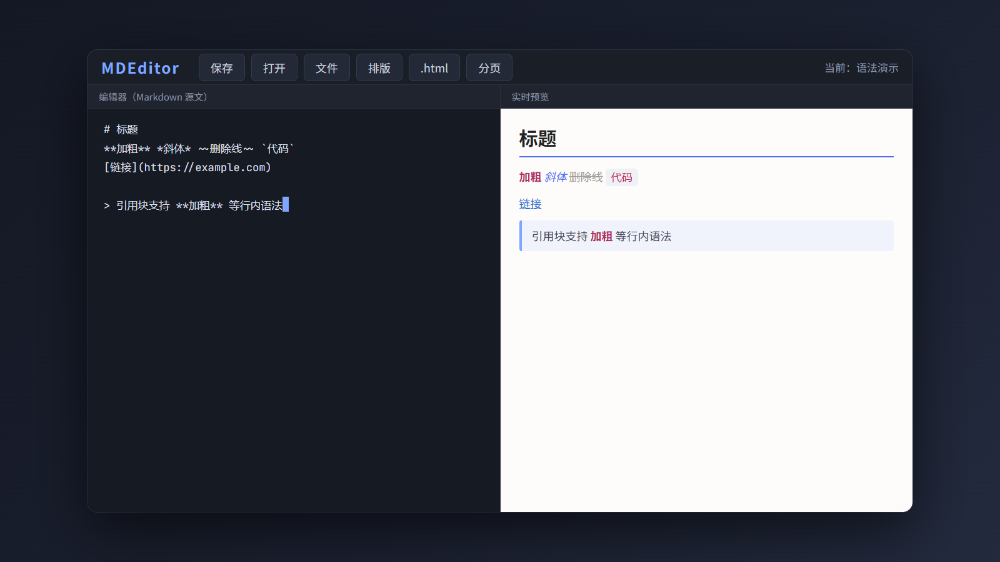
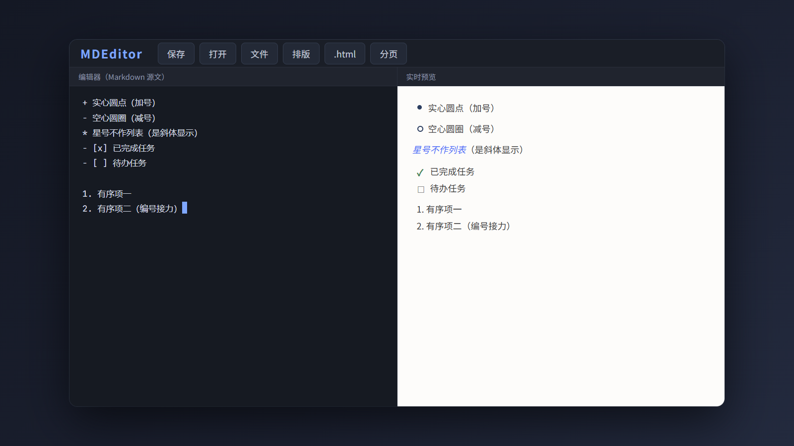
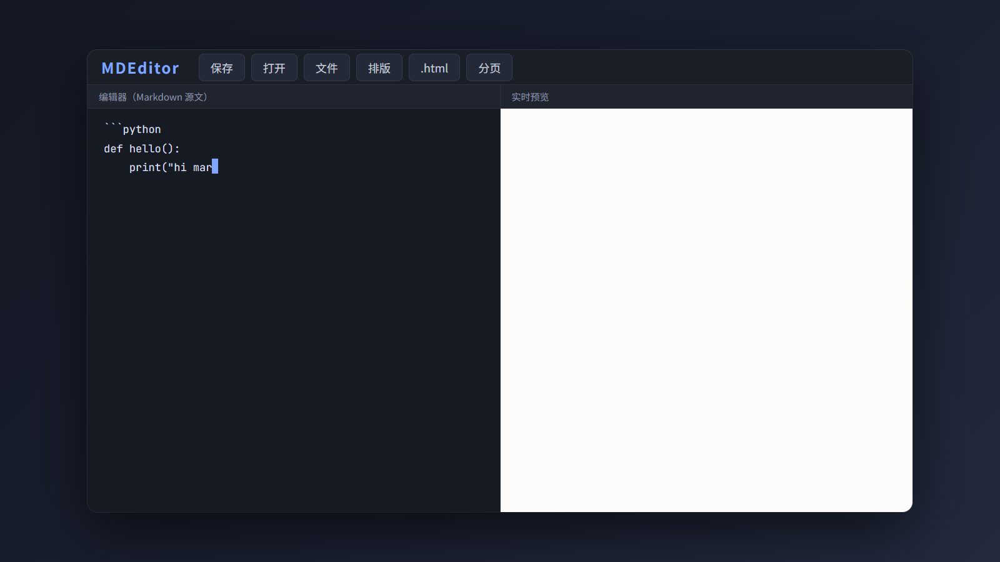
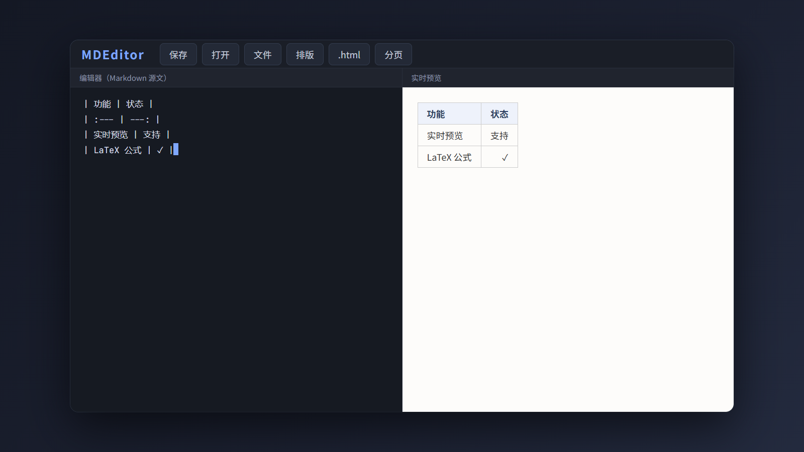
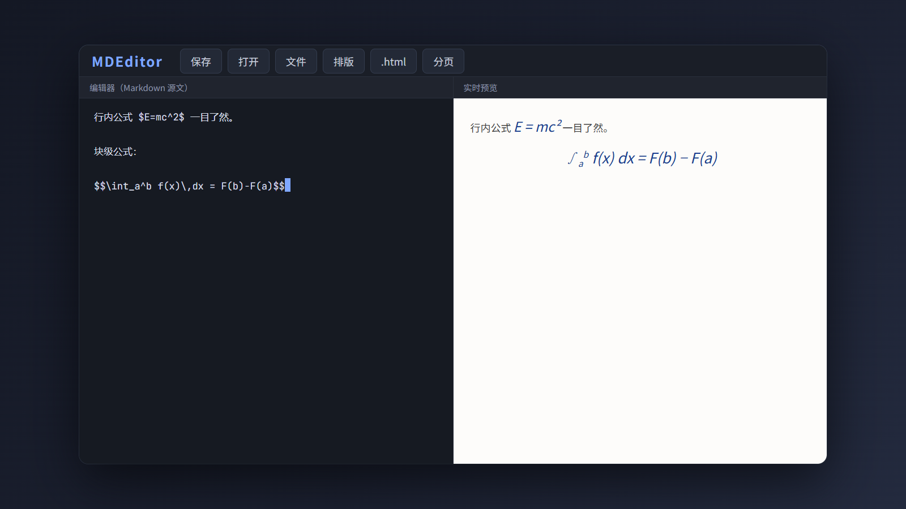
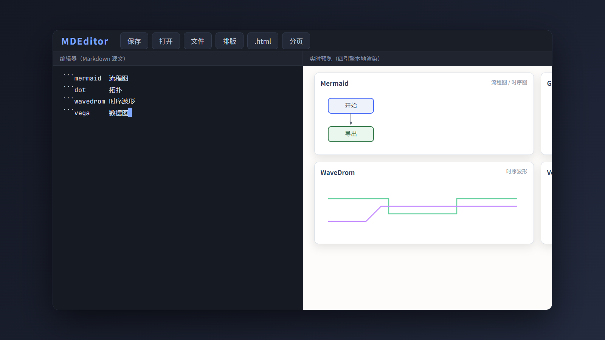
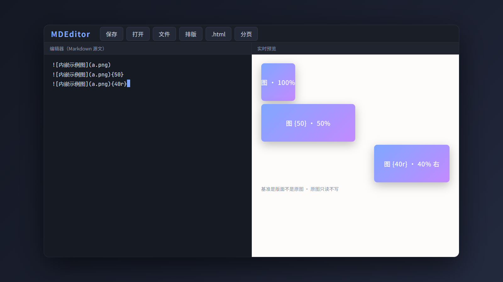
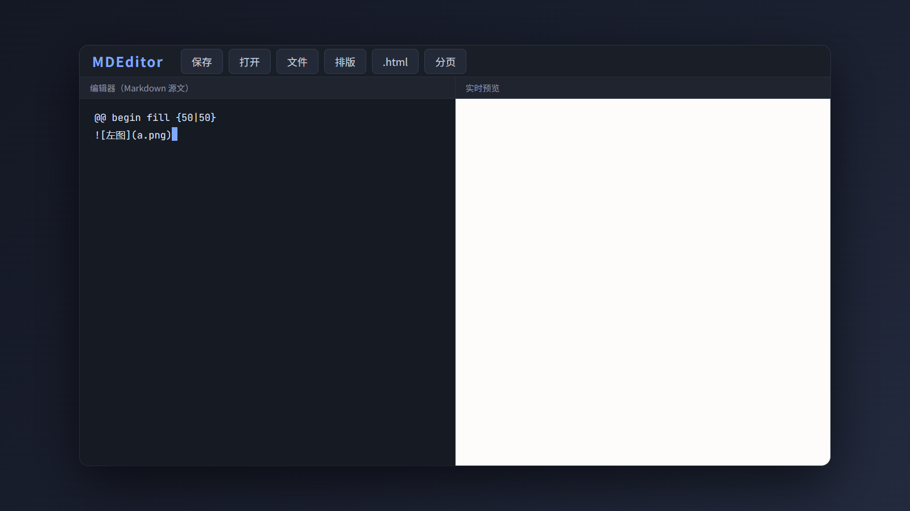
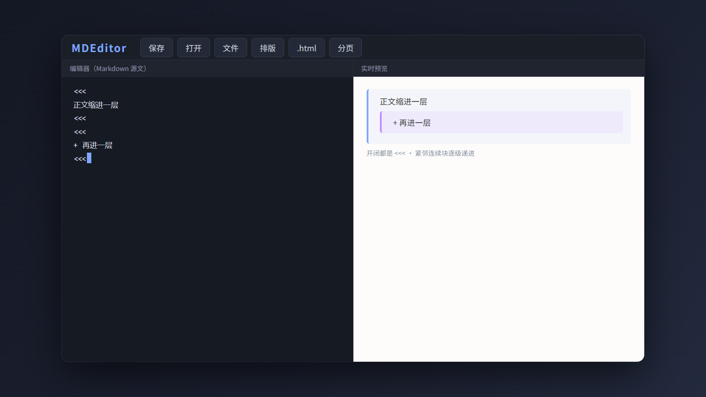
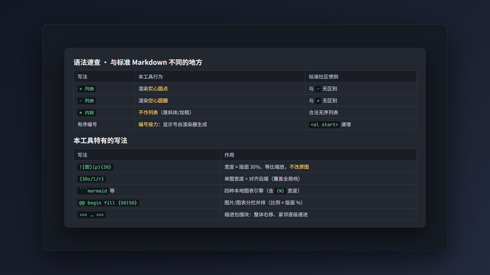

# MDEditor 的 Markdown 方言与排版


MDEditor 不是标准 Markdown 的照搬，而是一套**增强方言**：在标准语法之上加了一批自有写法，排版也由专门的面板按元素独立控制。这篇文档对应宣传视频，逐节讲解这些语法和排版能力，方便你写文档时对照。

语法速查总表在文末，记不住时直接翻到最后。

## 基础语法



标准部分与常见 Markdown 一致：

- `#` 写标题，`##` / `###` 写各级标题；
- `**双星**` 加粗、`*单星*` 斜体、`~~波浪线~~` 删除线；
- 反引号 `` `代码` `` 包住行内代码；
- `[链接](https://example.com)` 写链接；
- `>` 放在行首写引用块，引用内部同样支持加粗等行内语法。

左边写、右边立刻渲染，所见即所得。

## 列表方言



无序列表的标记符在本工具里有**独立语义**，这是与社区惯例最大的不同：

- `+` 渲染**实心圆点**；
- `-` 渲染**空心圆圈**；
- 样式跟标记符走，与缩进无关（缩进只决定嵌套层级）；
- `*` **不作列表标记**——`* 内容*` 按普通段落处理（`*星号*` 是斜体、`**双星**` 是加粗）；
- `- [x]` / `- [ ]` 是**任务列表**（可勾选样式的待办项）；
- 有序列表采用**编号接力**：显示编号由渲染器按区域顺序生成，你写的数字只是标记（写 `5.` 也按顺序显示）。

> 缩进嵌套子项是为承接外部 Markdown（GitHub / Typora / AI 输出）而保留的兼容语法；本工具自己表达层级退层，标准写法是下方的「缩进包围块」。

## 代码块



用三个反引号包住代码，后面标注语言，预览区就按对应语言高亮呈现：

````
```python
def hello():
    print("hi markdown")
```
````

写程序、贴配置，代码块都清清楚楚。

## 表格与对齐



表格用竖线分列，第二行的冒号控制对齐：

```
| 功能 | 状态 |
| :--- | ---: |
| 实时预览 | 支持 |
| LaTeX 公式 | ✓ |
```

- `:---` 左对齐；
- `---:` 右对齐；
- `:---:` 居中。

对齐规则一眼可辨，不必手调。

## 数学公式（KaTeX，本地渲染）



公式由 KaTeX 在本地渲染，**断网也能用**：

- 一个美元 `$...$` 是**行内公式**，例如质能方程 $E=mc^2$；
- 两个美元 `$$...$$` 是**块级公式**，例如积分 $\int_a^b f(x)\,dx = F(b)-F(a)$ 与求和 $\sum_{k=1}^{n} k = \frac{n(n+1)}{2}$。

即写即见，无需任何外部服务。

## 四种图表引擎，写在围栏里就出图



画流程图、依赖拓扑、波形、统计图，不用开外部工具——把代码块的语言标记写成对应引擎名，预览区立即出图：

| 围栏 | 引擎 | 擅长 |
| --- | --- | --- |
| ` ```mermaid ` | Mermaid | 流程图、时序图、状态机、甘特图、思维导图 |
| ` ```dot `（或 `graphviz` / `viz`） | Graphviz | 复杂依赖拓扑，自动布局质量最高 |
| ` ```wavedrom ` | WaveDrom | 数字信号时序波形（握手、寄存器时序） |
| ` ```vega ` | Vega-Lite | 数据图表（柱状、折线、散点等） |

四种引擎全部本地部署、**按需懒加载**（文档里没有图就零开销），断网照样渲染；暗色 / 亮色主题切换时图按新主题重绘。图表围栏同样支持版面百分比宽度（如 ` ```mermaid {30} `），规矩与图片宽度参数完全一致。

## 图片宽度 {N} 与对齐后缀



图片引用后面跟一个 `{数字}`，这张图的宽度就等于**版面宽度的百分比**（`{40}` 即版面的 40%，高度等比缩放）：

```

{50}
{40r}
```

- 基准是**版面**而不是原图：不同大小的原图，同参数即等宽；
- 参数范围 1~100，`{150}` 按 100 处理，非法值不生效且字面原样显示；
- 单图对齐后缀：`{40c}` 居中 / `{40l}` 左 / `{40r}` 右，覆盖「排版」面板的图片全局对齐档（`{c}` 纯对齐也合法）；
- **原始图片文件只读不写**：参数只决定显示与排版尺寸，预览、导出、分页切片均不修改原图。

图表围栏也支持同一参数（含对齐后缀），规矩与此处完全一致。

## 分栏 @@ fill



多张图（或图表）要并排成行，用分栏语法包起来，比例 = 各栏占**版面宽度的百分比**：

```
@@ begin fill {50|50}


@@ end fill
```

- 2~4 栏：`{50|50}`、`{30|30|40}`、`{25|25|25|25}`，**比例相加须 = 100**，否则整块按普通文本显示；
- 栏内容按空行分隔，每栏 = 一段连续内容（一个图表围栏，或若干图片行）；
- 栏内 `{N}` 失效：宽度全权由栏比例决定；
- 图片与图表可混排，预览 / 导出 HTML / 打印 / 导出 docx 同口径渲染。

## 缩进包围块 `<<< ... <<<`



这是本工具表达"整体缩进"的**标准语法**。需要某几段（或一个列表）整体再缩进一层时，用 `<<<` 把它们包起来：

```
<<<
正文缩进一层
<<<
<<<
+ 再进一层
<<<
```

- 开闭都是 `<<<`，不支持嵌套（块内再出现 `<<<` 即视为闭合）；
- 包围块的起始位置 = **上一段的缩进位置**：紧邻的连续块逐级递进，空行或其他块会打断继承；
- 标记行本身不显示；预览、导出、分页的缩进完全一致；
- 未闭合时标记按普通文本原样显示，便于发现漏写。

表达层级时，它比嵌套列表更可靠。

## 排版面板：按元素独立设置


排版不靠手调样式。工具栏的「排版」按钮打开面板，每种元素独立管理：

- 可设置的元素：正文 / H1 / H2 / H3~H6 / 引用 / 列表 / 表格 / 代码，**各自独立**设置字体、字号、对齐；
- 图片元素只有**对齐**档（图片无字体字号语义），单图可用 `{N c/l/r}` 后缀覆盖；
- 对齐支持：默认 / 左 / 居中 / 右 / 两端；
- 段落缩进按元素独立：**正文**提供首行缩进或悬挂缩进（字符数可调，随字号自动换算），**列表**与**引用**各只有一个「整体缩进」档；
- 「整体缩进」是容器级缩进，会被 `<<<` 缩进包围块的继承链使用。

改一次设置，整篇文档和导出结果同步生效；设置保存在本机 `runtime/ui-settings.json`，跨重启保留。表格还支持三线表、表头底色、首列底色。

## 语法速查



**与标准 Markdown 不同的地方：**

| 写法 | 本工具行为 | 标准社区惯例 |
| --- | --- | --- |
| `+` 无序列表 | 渲染实心圆点 | 与 `-` 无区别 |
| `-` 无序列表 | 渲染空心圆圈 | 与 `+` 无区别 |
| `*` 星号 | 只作行内斜体 / 加粗，**不作列表** | `* 内容` 是合法无序列表 |
| 有序列表编号 | 编号接力：显示号由渲染器生成 | `<ol start>` 逐项递增 |

**本工具特有的写法：**

| 写法 | 作用 |
| --- | --- |
| `{30}` | 图片宽度 = 版面 30%、等比缩放，不改原图 |
| `{30c}` | 宽度 + 单图对齐（c 居中 / l 左 / r 右） |
| ` ```mermaid {30} ` 等图表围栏带 `{N}` | 图表宽度 = 版面 N%，规矩同图片 |
| ` ```mermaid ` / ` ```dot ` / ` ```wavedrom ` / ` ```vega ` | 四种本地图表引擎 |
| `@@ begin fill {50\|50}` … `@@ end fill` | 图片 / 图表分栏并排 |
| `<<< ... <<<` | 缩进包围块，整体右移、紧邻逐级递进 |

约定：所有 `{N}` 类参数，数字为版面百分比（1~100，超界钳到 100，非法值不生效且字面保留）；图表围栏内 `wavedrom` / `vega` 必须是严格 JSON；原始文件永远只读。

## 收尾


MDEditor 把写作、渲染与导出收进本地：公式、分页、四图表引擎全部离线可用，左边写右边实时预览，关闭自动退出无残留。写作方言，排版自由，永不丢稿。

工具内置「版权与开源组件声明」文档，KaTeX、Paged.js、Python 及四种图表引擎的许可文本随附。本工具由 AI 辅助生成。

---

*宣传视频：`MDEditor-syntax.mp4`（约 105 秒，1600×900）。本文配图取自视频对应场景，隐去底部字幕条。*
