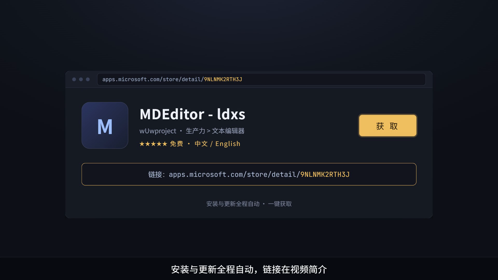
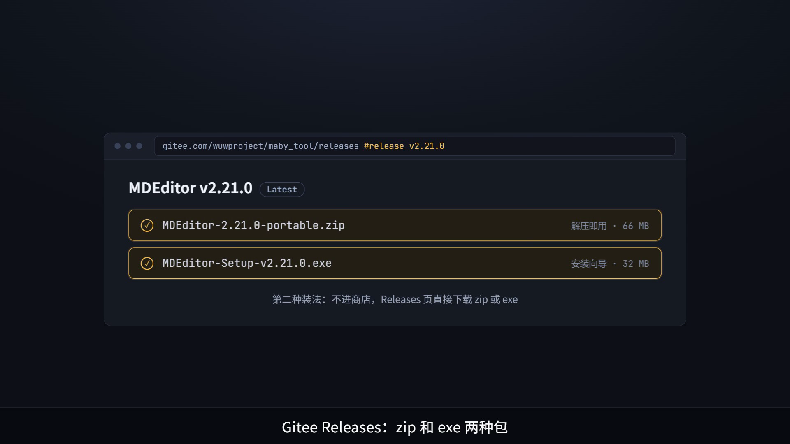
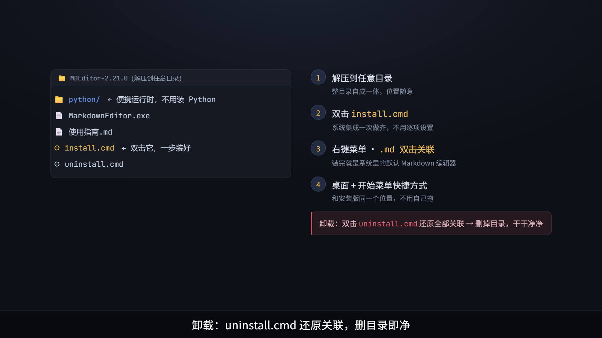
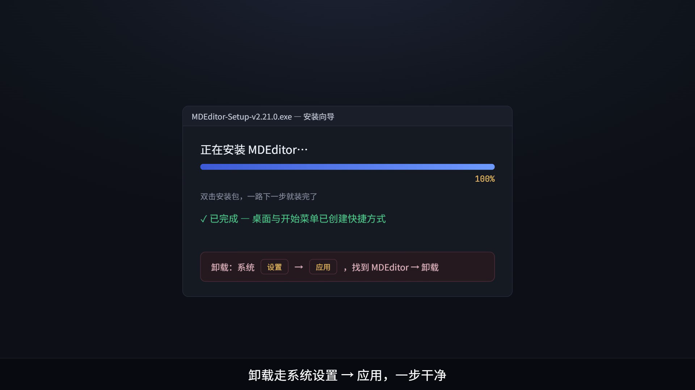
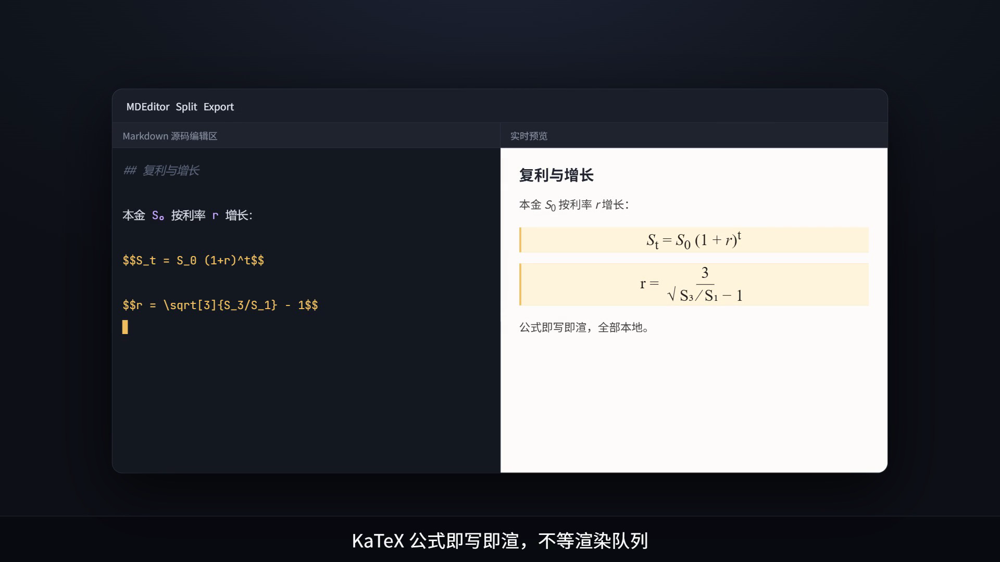
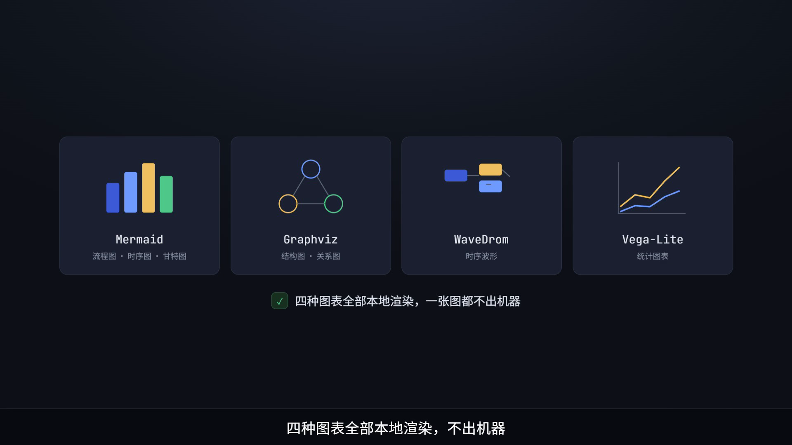
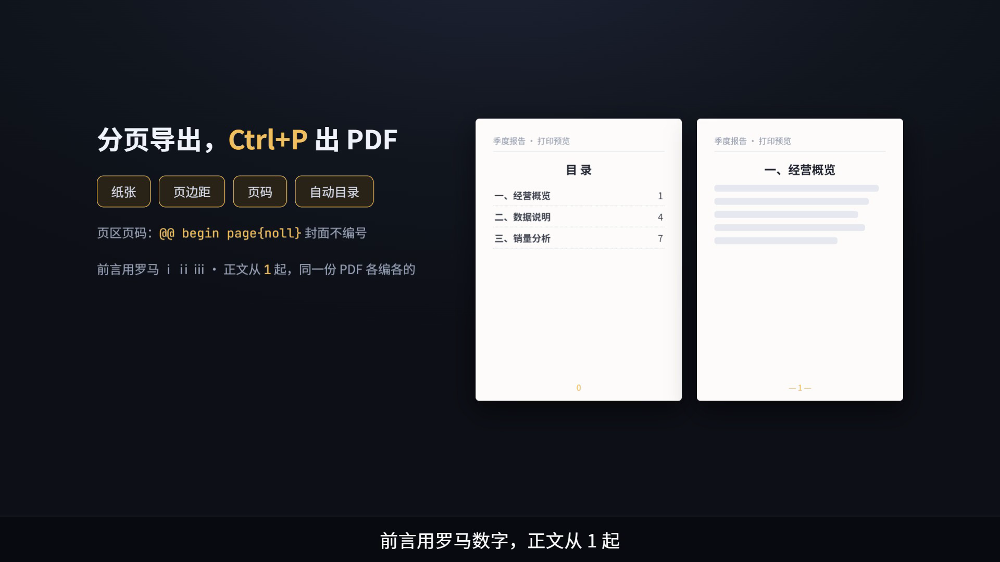
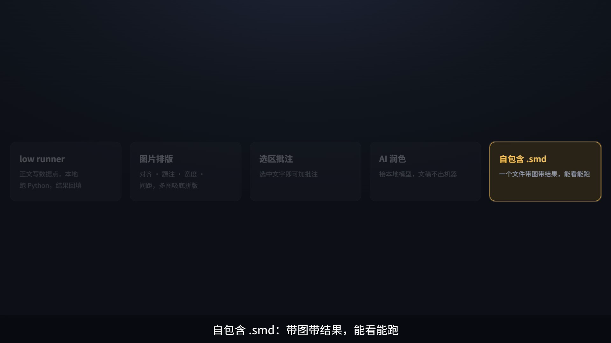

# MDEditor 上架微软商城了：两种安装方式 + 功能速览

> 配套视频：`MDEditor-Release.mp4`（约 115 秒，本文所有插图即视频分镜帧）

写了这么久的 MDEditor，终于上架**微软商店**了。不想进商店的用户也有第二种装法——Gitee Releases 直接下 zip 或 exe。这篇文章把两种安装、两种卸载讲清楚，最后把功能快速过一遍。

## 一、商店安装（最省事）

打开商店链接，点「获取」，安装与更新全程自动：

**https://apps.microsoft.com/store/detail/9NLNMK2RTH3J**

支持中文 / English 界面切换，免费，无广告，无内购。

## 二、安装包安装（Gitee Releases）

到仓库 Releases 页下载安装包：

**https://gitee.com/wuwproject/maby_tool/releases#release-v2.21.0**

两个包任选其一，装法和卸法如下。

### zip 包：解压即用

1. **解压到任意目录**——整个目录自成一体，内置便携 Python 运行时，系统里不需要装 Python，位置随意；
2. **双击 `install.cmd`**——它做三件事：注册右键菜单（任意 `.md` 右键 → Open with Markdown Editor）、关联 `.md` 双击打开、在桌面和开始菜单创建快捷方式；
3. 之后**双击任意 `.md` 文件**就能开始写。

**卸载**：双击 `uninstall.cmd` 还原右键菜单与文件关联，再把目录一删——干干净净，注册表不残留（注册的全部是用户级条目，不需要管理员权限）。

> 不想装右键/关联？只双击 `desktop-shortcut.cmd`，仅在桌面创建快捷方式。

### exe 包：安装向导

1. **双击 `MDEditor-Setup-v2.21.0.exe`**，一路下一步，装完自动创建桌面与开始菜单快捷方式；
2. **卸载**：系统「设置 → 应用 → 已安装的应用」找到 MDEditor，点卸载，一步干净。

## 三、MDEditor 是什么

一款**本地优先**的 Markdown 编辑器：左侧写作、右侧实时渲染。除 AI 推理需要本地模型服务外，**全部功能离线可用**，文档不出机器。

### 实时预览 + 公式

KaTeX 数学公式即写即渲，行内、块级、分式、根号都支持。

### 四种图表，全部本地渲染

Mermaid（流程/时序/甘特）、Graphviz（结构图）、WaveDrom（时序波形）、Vega-Lite（统计图表），渲染全在本机完成。

### 分页导出 + 页区页码

纸张、页边距、页码、自动目录，`Ctrl+P` 直接出 PDF。页区页码用 `@@ begin page{noll|1|i|I}` 划段：封面不编号、前言用罗马 ⅰ ⅱ ⅲ、正文从 1 起——同一份 PDF 里各编各的。

### 还有这些

- **low runner**：正文里写数据点，run 库在本地子进程跑 Python，结果（文本/表格/图片）落回正文；
- **图片排版**：对齐、题注、宽度、间距，多图吸底拼版；
- **选区批注 + AI 润色**：批注锚点随文同步；润色对接 LM Studio / Ollama 本地模型；
- **自包含 `.smd`**：一个文件带图带结果，发给别人打开就能看、能跑。

## 链接汇总

| 渠道 | 地址 |
|---|---|
| 微软商店（一键获取，自动更新） | https://apps.microsoft.com/store/detail/9NLNMK2RTH3J |
| zip / exe 安装包（Gitee Releases） | https://gitee.com/wuwproject/maby_tool/releases#release-v2.21.0 |

数据进来，结果回去，版式留下来。
